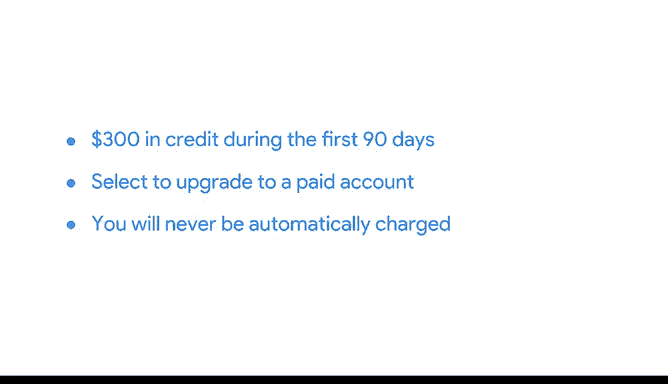

# 谷歌数据分析师第三课《为数据探索做准备》data-preparation（中英字幕）deepseek - P30：30_03_01_熟悉BigQuery_沙盒环境与计费选项.zh_en - GPT中英字幕课程资源 - BV19X4y1n7Xd

Hi and welcome back。 Throughout this course， you've seen how BigQuery can be used to view and analyze data from tons of sources。

 Now， we're going to explore the different account here that BigQury offers so you know how to choose the right one for your needs and how you can access them。

😊，Big queries offered to you at no charge。 There are paid options available。

 but we won't need them for the activities in this course。 Instead。

 we're going to talk about two account types， sandbox and free trial。

 A sandbox account is available at no charge， and anyone with a Google account can log in and use it。

There are a couple of limitations to this account type。 For example。

 you get a maximum of 12 projects at a time。This means that if you want to make a 13th project。

 you'll have to delete one of your original 12。It also doesn't allow you to insert new records to a database or update the field values of existing records。

These data manipulation， language or DML operations aren't supported in the sandbox。However。

 you won't need to do this in course activities。 You can read more about the limitations of a sandbox account in the Bigqueied documentation。

This is the account type we'll use for most of our activities。Before that， though。

 we should talk about the other way to use BigQury without charges。 the Google Cloud free trial。

The free trial gives you access to more of what BigQury has to offer with fewer overall limitations。

The free trial offers $300 in credit for use in Google Cloud during the first 90 days。

 You won't get anywhere near that spending limit if you just use the Bigque console to practice SQL queries After you spend the $300 credit or after 90 days。

 your free trial will expire， and you will need to personally select to upgrade to a paid account to keep working in Google Cloud。

😊，Your method of payment will not be automatically charged after your free trial ends。

The free trial does require that you set up a payment option with Google Cloud。

 but unless you choose to opt in for an account upgrade， it won't charge you。 However。

 it does require you to enter a payment type。 So we understand if you don't feel comfortable with this option。

This is one reason the BigQuery Sandbox account exists。

 so you don't have to enter any payment information。With either type of account。

 you can upgrade to a paid account at any time and retain all of your existing projects。

 If you set up a free trial account， but choose not to upgrade to a paid account when your trial period ends。

 you can set up a free sandbox account at that time。

