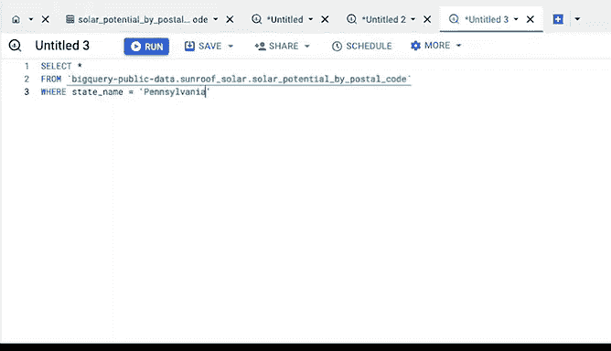

# 谷歌数据分析师第三课《为数据探索做准备》data-preparation（中英字幕）deepseek - P31：31_03_05_BigQuery实战应用.zh_en - GPT中英字幕课程资源 - BV19X4y1n7Xd

You've learned how sorting and filtering data in spreadsheets helps data analysts customize the information。

 customizing data makes it more meaningful and easier to understand， analyze and visualize。😊。

You also discovered that some spreadsheets can be extremely long and complex。

 so knowing how to zero in on the exact data you need while setting aside the rest helps you focus on your analysis。

This is also true for databases。 Sometimes a data is too large to download or it won't fit in a spreadsheet。

 so a data analyst will use SQL to create a query to view the specific data that they want from within the larger set。

 We've learned that a database is a collection of data stored in a computer system and that SQL stands for a structured query language。

 Data analysts use query languages to communicate with a database。 In an earlier video。

 you also learn that a relational database contains a series of tables that can be connected to form relationships。

 These relationships are represented by primary and foreign keys。

Data analysts write queries in order to get data from these tables。 Let's see how this works。

 We'll start with our table viewer。Here we can see what public data sets are available。

 We'll scroll through the data before we start using it to get a feel for what it's all about and to make sure it's clean。

Some table viewers let you preview a few rows before even writing a query。

 This is helpful if you want to take a quick look to be sure the data set will be right for your project to show you how this works。

 let's check out a sample dataset set。 This one shows how much sunlight hits rooftops in a year。😊。

This would be very useful for a data analyst working on a solar energy project， for example。

We'll start by previewing the data。Then we'll select a subset of this data where we find regions。

 states， yearly sunlight， and more。 Now to see the entire data， let's write a query。

 The first step is finding out the complete correct name of the dataset to do this。

 select the data So potential by postal code， and select query table。

The name of the data set is shown inside the two Batics。

 This is to help us read the query more easily。 We can also remove the backtics in this case。

 and our query would still run。😊，The words you see before the dot represent the database name。

And the words after the dot represent the table name。

Let's select and copy the data name now because we'll need it in a second。

Now we'll click on the plus sign to compose a new query。Most queries begin with the word select。

Then we add a space。Because we want to see the entire data set， we'll put an asterisk next。

The asterisk says we want to include all columns。 This is a great shortcut because without it。

 we'd have to type in every single field name。Next， we'll press Return and type from。

Front does just what it sounds like。 It indicates where the data is coming from。 After that。

 we'll add another space。Now we paste in the name of the data that we copied earlier。And finally。

 run the query。Now we can carefully inspect the data before we begin working with it。

 One important thing to keep in mind， SQL queries can be written in a lot of different ways。

 but still provide the same results。 For example， we could have written this query as one long line of instructions like this。

And we'd still get the same results。The additional lines and spaces don't impact the query's outcome。

 but they keep your query organized and easier to read for yourself and others。Now。

 if the project doesn't require all of these fields。

 we can use SQL to view a particular piece or pieces of data to do this。

 we specify a certain column name in the query。For example。

 maybe we only want to see data from Pennsylvania， so we'd begin our query the same way we just learned。

 select space， add an asterisk。Then from our solar potential database， but this time we'll add where。

So add a space and state underscore name， the name of the column。Now。

 because we only want to see data from Pennsylvania。

 we add an equal sign and the word Pennsylvania with single quotes around it。In SQL。

 single quotes indicate the beginning and ending of a string； finally， rerun the query。

Now we can review the data on solar potential for only Pennsylvania。 Now we've got the data we want。

 and we're ready to start putting it to work， which we'll cover later on。😊，But for now。

 let's celebrate finishing another module。 You've covered a lot of complex and highly technical information。

 as you keep practicing， though， things will start to feel a lot more natural。 For now。

 take a moment to sit back and think about all you've learned。

 you discovered metadata and how it keeps data organized by describing what that data is all about。

 You've seen how internal and external data or access and how data analysts use them to find compelling insights to solve business problems。

 and you can sort and filter your data to really pinpoint the information you need。 Finally。

 you just learned about queries and you even practice writing some。😊，Coming up。

 you'll have a few readings and then a weekly challenge to test your knowledge。

 This will help you confirm that you've understood what we've worked on in these videos。

 and as always， if you're ever unsure about a question。

 I highly encourage you to review the videos and readings to find the answer。

 You're the data detective now so use those skills。

 Keep up the great work and I'll see you after the weekly challenge。

