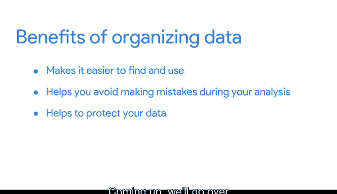

# 谷歌数据分析师第三课《为数据探索做准备》data-preparation（中英字幕）deepseek - P32：32_04_01_对数据建立信心.zh_en - GPT中英字幕课程资源 - BV19X4y1n7Xd

。Hey， good to have you back Up until now we focused on preparing your data for processing and analysis In these next videos we'll explore another big part of that process。

 organizing and protecting your data keeping your data organized is important for a few reasons it makes it easier to find and use helps you avoid making mistakes during your analysis and helps to protect it。

Coming up， we'll go over the basics of organizing data for personal and professional use and file naming conventions。

 then we'll take a look at some security features for spreadsheets。

By the end of these next few videos， you'll be able to do all these things and you'll be able to explain these steps to stakeholders so they can feel confident that your data practices are safe and secure。

When you're ready to get started， go ahead to the next video there we'll get started with organizing data for personal use。

