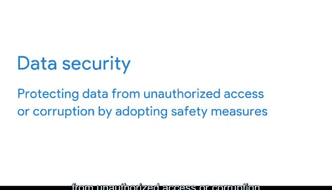
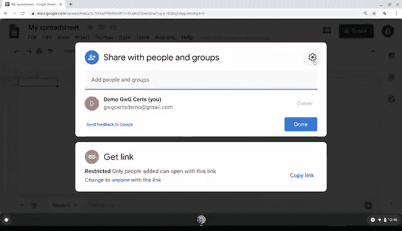
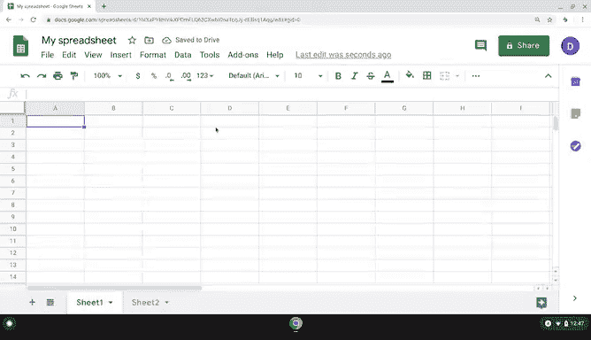

# 谷歌数据分析师第三课《为数据探索做准备》data-preparation（中英字幕）deepseek - P34：34_04_01_电子表格中的安全功能.zh_en - GPT中英字幕课程资源 - BV19X4y1n7Xd

You're back okay now that our data is organized and easy to find it's time to start thinking about how to protect it The good news is that spreadsheets come with security features already built in in this video we'll look at different spreadsheet programs and how their security features like sheet protections and access control are similar when I say security features you might be imagining ways to protect data from other people but that's just one kind of security security features can be designed to keep unauthorized users from viewing certain files or just lock your worksheets so that you don't accidentally break your formulas This is called data security data security means protecting data from unauthorized access or corruption by adopting safety measures。

Whatever spreadsheet program you're using will have similar security measures built in As a data analyst。

 you'll run into Google Sheets and Excel a lot。 So let's talk about what they have in common。 First。

 both programs have features that let you protect your spreadsheets or parts of your spreadsheets from being edited。

😊，From the entire worksheet down to single cells in a table。

So if you're collaborating with other users， you can easily lock down your formulas so that they aren't accidentally broken Spea of collaborating。

 Excel and Google Sheets both have access control features like password protection and user permissions This gives you more control over who can do what to your spreadsheet。

Because these programs are located in different places。

 these features are slightly different for Excel spreadsheets。

 you can encrypt files and worksheets with passwords before emailing them to other users in Google Sheets。

 these settings are found under the Sha menu， which allows you to control who can see or edit the sheet online。

Google sheetets can also be copied so that users can work with that data without altering the original tabs can also be hidden and unhidden in sheets and Excel。

 allowing you to change what data is being viewed， but remember even hidden tabs can be unhidden by someone else so be sure you're okay with those tabs still being accessible as a data analyst data security will be a priority but no matter which program use to create spreadsheets。

 there security features to help you keep your work safe and secure there are some other basic best practices you can take to keep your data more secure overall which we'll cover later in a reading。

You've made it to the end of this module congrats in these videos we've covered strategies for organizing data for personal and work use。

 how to develop functional file naming conventions and some security measures you can take advantage of in spreadsheets Before you move on to the next step in the data analysis lifecycle it's important that you make sure your data is prepared and that includes organizing and securing it As usual after this video you'll have your weekly challenge I know you've got this。

😊，Then after the weekly challenge there's some optional material all about connecting to the online data community as you start building your career in data analytics。

 it'll be really valuable to connect with others， learn about new trends in the field and share your own work I think you'll get a lot out of those videos they'll help you develop a professional online presence and find ways to communicate with people in your field。

 which is key as networking becomes more and more online and remote work opportunities become the norm。

But if you feel pretty confident about your online presence。

 you can move into the course challenge instead。 Good luck on this weekly challenge。

 and I'll see you soon。😊。