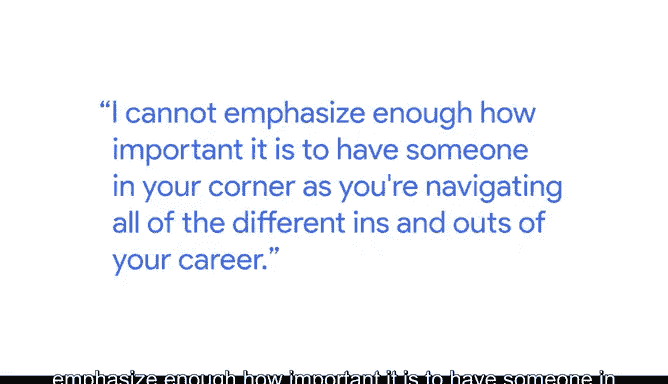
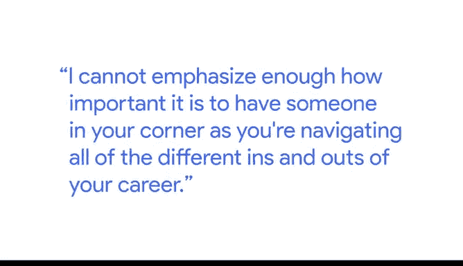
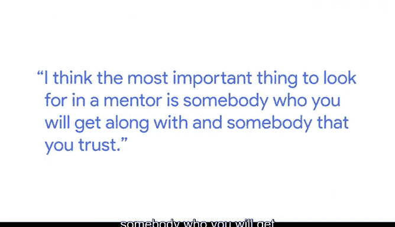

# 谷歌数据分析师第三课《为数据探索做准备》data-preparation（中英字幕）deepseek - P35：35_05_02_Rachel_导师是关键.zh_en - GPT中英字幕课程资源 - BV19X4y1n7Xd

Hi， my name is Rachel， and I'm the business systems and analytics lead at Verily。

 I've been lucky enough to have some really great mentors over the course of my career。

 and I cannot emphasize enough how important it is to have someone in your corner as you're navigating all of the different ins and outs of your career。

For me， I've had some wonderful mentors who have guided me through some really tough career decisions。

 starting way back at the very beginning。 My first mentor was a professor at school。

 And this professor， what gave me wonderful advice of。😊。

How to follow my dreams and how to lean into what I was interested in。

 I think it's very important to also have great mentors at work。

 My mentor helps me navigate all the ins and outs of my organization or the ins and outs of the politics sometimes and also helps me make decisions on what to do next And so it's nice to have a mentor who's outside of what's going on。

 but it's also really nice to sometimes have a mentor who understand the environment。

 I catch up with my mentor regularly， just to touch base just to see what we're doing to maintain a relationship。

 but I specifically will schedule time with my mentor when I'm wrestling with some sort of tough question or when I have a pivotal moment coming up。

 For example， I've had some great conversations with my mentor about whether I really lean in on the finance side of my career or whether I want to lean in on the I side and the system side and helping make some of those decisions about where to focus and what what to take some classes in。

 what to continue。cation on and where to lean in next with upcoming projects。

 talking that through with somebody has really helped me make sense of some jumbled thoughts and figure out where to go next。

 I think the most important thing to look for in a mentor is somebody who you will get along with and somebody that you trust This is a person that you're going to go to with some of potentially the toughest choices of your career looking to them for guidance and for help and for support my most successful mentors。

 the most successful mentoring relationships that I've had have been with people who I'm close to personally or professionally and who I trust and who I feel comfortable sharing potentially deep thoughts with and a lot of really a lot of potentially sensitive details about what I'm thinking what I'm going through and what I want to help so that they can help me make sense of that and figure out what to do and I love now that I can pay that forward and share some of the wisdom that I've learned from my mentors and from some of the experiences。

I've had in my career and help share that with someone else so that they can navigate some of their same decisions in some of those same situations and hopefully learn from some of my experiences and some of my mistakes and helping pay that forward is what's really exciting about being a mentor。

