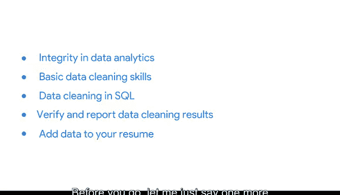

# 谷歌数据分析师第三课《为数据探索做准备》data-preparation（中英字幕）deepseek - P36：36_05_03_祝贺_课程总结.zh_en - GPT中英字幕课程资源 - BV19X4y1n7Xd

Welcome back before we get started， let's take a moment to celebrate how far you've come and everything you've learned in this course you're almost halfway through this program thanks for sticking with it。

 so far you've learned about data types and data structures and discovered the importance of bias and credibility in data preparation and analysis we also explore databases。

 different ways to organize and protect your data and even how to join the data analytics community。

All of this will help you prepare your data for the next step in the data analysis lifecycle processing processing your data to make sure that it's clean and complete is the last step you take before you start analyzing it and that's exactly what the next course is all about I'm excited to reintroduce fellow Googlers Sally performance measurement and analytical lead she's going to be your guide throughout this next course which is all about cleaning and processing your data for analysis Com up you're going to learn about integrity and data analytics。

 basic data cleaning skills and data cleaning and SQL we'll also learn how to verify and report your data cleaning results and if you're up for it adding data to your resume before you go let me just say one more time fantastic job when you're ready。

 you can go ahead and start the next course Sally will be there to guide you through it。

