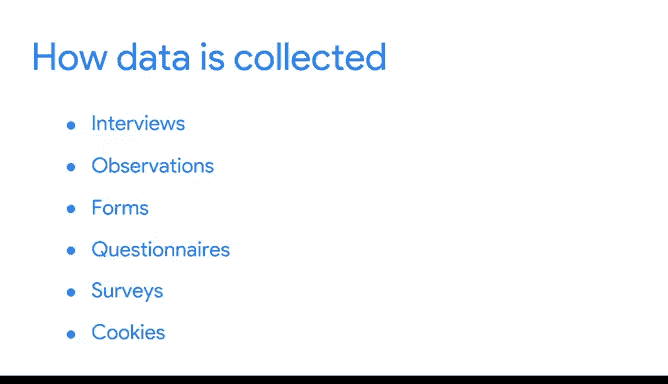

# 谷歌数据分析师第三课《为数据探索做准备》data-preparation（中英字幕）deepseek - P3：03_01_01_现实世界中的数据收集.zh_en - GPT中英字幕课程资源 - BV19X4y1n7Xd

Right now， data is being generated all around the world。

 and we're talking tons of data every minute of every day。

 millions of texts and hundreds of millions of emails are sent on top of that。

 millions of online searches are made and videos viewed and those numbers are only growing that's a lot of data so let's learn more about how it's made and used In this video we'll talk about the ways that data can be generated and how industries collect data themselves。

Every piece of information is data， and all that data is usually generated as a result of our activity in the world。

These days， we spend a lot of time online with social media and mobile devices。

 Mill and millions of people are adding to the huge amount of data out there each and every day。

 Think about it like this。 Every digital photo online is one piece of data。

 and every photo itself holds even more data from the number of pixels to the colors contained in each of those pixels。

 but that's not the only way data is made。 We can also generate data by collecting information。

 This kind of data generation and collection comes with a few more things to think about。

 It needs to be done with consideration to ethics。 so that we maintain people's rights and privacy。

 We'll learn more about that later on。 For now， let's check out a real world example。

 The United States Census Bureau uses forms to collect data about the country's population。

 This data is used for a number of reasons， like funding for schools， hospitals and fire departments。

 The bureau also collects information about things like US businesses。

 C their own data in the process。 The great thing about。😊。

Is that others can then use the data for their own needs， including analysis。

 The annual business survey is used to figure out the needs of businesses and how to provide them with resources to help them succeed。

 I actually generate data in the analytics I do for the healthcare industry。

 We run a lot of surveys to learn how patients feel about certain things related to their health care。

 For example， one survey asked how patients feel about telemedicine versus in-person doctor visits。

 The data we collected help the companies we work with， improve the care that their patients receive。

😊，Survey data is just one example， there's all kinds of data being generated all the time。

 and there's lots of different ways to collect it。Even something as simple as an interview can help someone collect data。

Imagine you're in a job interview to impress the hiring manager。

 you'll want to share information about yourself。The hiring manager collects that data and analyzes it to help them decide whether to hire you or not。

 but it goes both ways。 You could also collect your own data about the company to help you decide if the company is a good fit for you。

 or you can use the data you collect to come up with thoughtful questions to ask the interviewer。

Scientists also generate data to use a lot of observations in their work for example。

 they might collect data by studying animal behavior or looking at bacteria under a microscope Earl we talked about the forms that the US Census Bureau uses to collect data forms。

 questionnaires and surveys are commonly used ways to collect and generate data。 One thing to note。

 data that's generated online doesn't always happen directly Have you ever wondered why some online ads seem to make really accurate suggestions or how some websites remember your preferences This is done using cookies。

 which are small files stored on computers that contain information about users cookies can help inform advertisers about your personal interests and habits based on your online surfing without personally identifying you。

As a real world analyst， you'll have all kinds of data right at your fingertips and lots of it， too。

 Knowing how it's been generated can help add context to the data and knowing how to collect it can make the data analysis process more efficient。

Coming up， you'll learn how to decide what data to collect for your analysis， so stay tuned。

