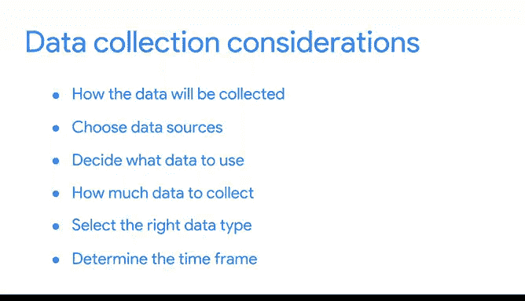

# 谷歌数据分析师第三课《为数据探索做准备》data-preparation（中英字幕）deepseek - P4：04_01_02_确定需要收集的数据.zh_en - GPT中英字幕课程资源 - BV19X4y1n7Xd

Welcome back。 We've talked a lot about all the data out there in the world。 But as a data analyst。

 you'll need to decide what kind of data to collect and use for every project。

 And with a nearly endless amount of data out there， this can be quite a bit of a data dilemma。

 But there's good news In this video， you'll learn which factors to consider when collecting data。

 Usually， you'll have a head start in figuring out the right data for the job。

 because the data you need will be given to you or your business task or problem will narrow down your choices。

 So let's start with a question like what's causing increased rush hour traffic in your city。😊，First。

 you need to know how the data will be collected。 you might use observations of traffic patterns to count the number of cars on city streets during particular times you notice that cars are getting backed up on a specific street that brings us to data sources In our traffic example your observations will be firstpart data This is data collected by an individual or group using their own resources Collecting first party data is typically the preferred method because you know exactly where it came from。

You might also have second party data， which is data collected by a group directly from its audience and then sold so in our example。

 if you aren't able to collect your own data， you might buy it from an organization that's led traffic pattern studies in your city This data didn't start with you。

 but it's still reliable because it came from a source that has experience with traffic analysis。

The same can't always be said about third party data or data collected from outside sources who did not collect it directly。

 This data might have come from a number of different sources before you investigated it。

 So it might not be as reliable。 but that doesn't mean it can't be useful。

 you'll just want to make sure you check it for accuracy， bias and credibility actually。

 no matter what kind of data you use， it needs to be inspected for accuracy and trustworthiness。

 Well learn more about that process later。 For now。

 just remember that the data you choose should apply to your needs and it must be approved for use。

 As a data analyst， it's your job to decide what data to use。

 and that means choosing the data that can help you find answers and solve problems and not getting distracted by other data。

In our traffic example， financial data probably wouldn't be that helpful。

 but existing data about high volume traffic times would be。

Okay now let's talk about how much data to collect in data analytics。

 a population refers to all possible data values in a certain data set。

 so if you're analyzing data about car traffic in a city your population would be all of the cars in that area。

 but collecting data from the entire population can be pretty challenging。

 that's why a sample can be useful a sample is a part of a population that is representative of the population。

 you might collect a data sample about one spot in the city and analyze a traffic there。

 or you might pull a random sample from all existing data in the population how you choose your sample will depend on your project。

As you collect data， you'll also want to make sure you select the right data type for traffic data。

 An appropriate data type could be the dates of traffic records stored in a date format。

 The dates could help you figure what days of the week there is likely to be a high volume of traffic in the future。

 We'll explore this topic in more detail soon。Finally。

 you need to determine the timeframe for data collection in our example。

 if you needed an answer immediately， you'd have to use historical data。

 which is data that already exists， but let's say you needed to track traffic patterns over a long period of time that might affect the other decisions you make during data collection and now you know more about the different data collection considerations you'll use as a data analysts and because of that you'll be able to find the right data when you start collecting it yourself there's still more to learn about data collection。

 so stay tuned。

