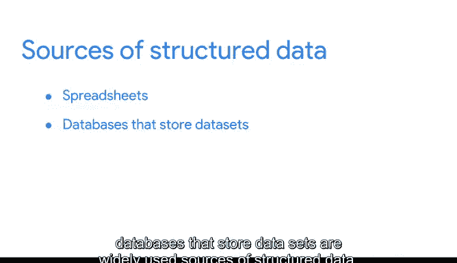

# 谷歌数据分析师第三课《为数据探索做准备》data-preparation（中英字幕）deepseek - P6：06_01_03_继续探索结构化数据.zh_en - GPT中英字幕课程资源 - BV19X4y1n7Xd

Hi， great to see you again。 Earl， we compared some data formats。

 including structured and unstructured data。 Most of the data being generated right now is actually unstructured。

 audio files， video files， emails， photos and social media are all examples of unstructured data。

 These can be harder to analyze in their unstructured format。 But here's the good news。

 you'll be working with structured data most of the time。 For example。

 if you need to analyze data about the unstructured data and emails， photos and social media sites。

 it'll most likely be structured for analysis before you even get to it because of that。

 I want to explore structured data a bit more as a quick refresher。

 structured data is data organized in a format like rows and columns。

 but there's definitely more to it than that。 structured data works nicely within a data model。

 which is a model that is used for organizing data elements and how they relate to one another。

 What are data elements。 Their pieces of information such as people's names， account number。😊。

And addresses data models help to keep data consistent and provide a map of how data is organized。

 This makes it easier for analysts and other stakeholders to make sense of their data and use it for business purposes In addition to working well within data models structured data is also useful for databases This makes it easy for analysts to enter query and analyze the data whenever they need to This also helps make data visualization pretty easy because structured data can be applied directly to charts。

 graphs， heat maps， dashboards and most other visual representations of data。Alright。

 so now we know that spreadsheets and databases that store data sets are widely used sources of structured data。

 After you explore some other data structures， you'll check out more data types using a spreadsheet。

 The adventure continues。

