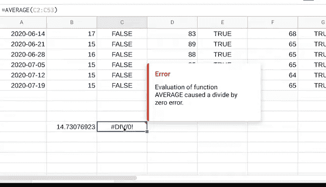

# 谷歌数据分析师第三课《为数据探索做准备》data-preparation（中英字幕）deepseek - P7：07_01_01_了解你正在处理的数据类型.zh_en - GPT中英字幕课程资源 - BV19X4y1n7Xd

By now， you've learned a lot about data， from generated data to collected data to data formats。

 It's good to know as much as you can about the data you'll use for analysis。 In this video。

 we'll talk about another way you can describe data。 The data type。

 A data type is a specific kind of data attribute that tells what kind of value the data is。

 In other words， a data type tells you what kind of data you're working with。😊。

Data types can be different depending on the query language you're using。 For example。

 SQL allows for different data types， depending on which database you're using。 For now， though。

 let's focus on the data types that you'll use in spreadsheets to help us out。

 We'll use a spreadsheet that's already filled with data。

 We'll call it worldwide interest in suites through Google searches。 Now。

 a data type in a spreadsheet can be one of three things。 a number， a text or string or a boolean。

 you might find spreadsheet programs that classify them a bit differently or include other types but these value types cover just about any data you'll find in spreadsheets。

 We'll look at all of these in just a bit。😊，Looking at columns， B， D， and F。

 we find number data types。Each number represents the search interest for the terms cupcakes。

 ice cream and candy for a specific week。 The closer a number is to 100。

 The more popular that search term was during that week。100 it represents peak popularity。

 Keep in mind that in this case，100 is a relative value。 Not the actual number of searches。

 It represents the maximum number of searches during a certain time。

 Think of it like a percentage out of test。 All other searches are then also valued out of 100。

 You might notice this in other data sets as well。 Gold star for 100。 If you needed to。

 you could change the numbers into percent or other formats like currency。😊。

These are all examples of number data types in column H。

 the data shows the most popular treat for each week based on the search data。

 so as we'll find and sell H4 for the week beginning July 28， 2019。

 the most popular treat was ice cream， This is an example of a text data type or a string data type which is a sequence of characters and punctuation that contains textual information。

In this example， that information would be the treats and people's names。

These can also include numbers like phone numbers or numbers and street addresses。

 but these numbers wouldn't be used for calculations。 So in this case， they're treated like text。

 not numbers。In columns C， E， and G， it seems like we've got some text。

But the text here isn't a text or string data type。 Instead， it's a boolean data type。

 A Boolean data type is a data type with only two possible values， Tru or false。 columns C， E。

 and G show Boolean data for whether the search interest for each week is at least 50 out of 100。

Here's how it works to get this data， we've created a formula that calculates whether the search interest data in columns B。

 D and F is 50 or greater in cell B4， the search interest is 14。 So in cell C4。

 we find the word false because for this week of data， the search interest is less than 50。

 So for each cell in columns C E and G。 the only two possible values are true or false。

 We could change the formula so other words appear in these cells instead。

 but it's still boolean data。 you'll get a chance to read more about the Boolean data type soon。

Let's talk about a common issue that people encounter in spreadsheets。

 mistsaking data types with cell values。 For example， in cell B 57。

 we can create a formula to calculate data in other cells。

 This will give us the average of the search interest in cupcakes across all weeks in the data set。

 which is about 15。 The formula works because we calculated using a number data type。

 But if we try it with a text or string data type like the data in column C， we'd get an error。

 error values usually happen if a mistake is made in entering the values in the cells。

 So the more you know your data types and which ones to use， the less errors you'll run into。

 There you have it。 A data type for everyone。 And we're not done yet。 coming up。

 we'll go deeper into the relationship between data types， fields and values。 See you soon。

