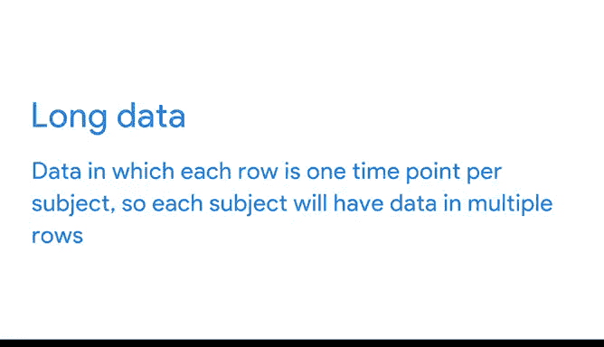

# 谷歌数据分析师第三课《为数据探索做准备》data-preparation（中英字幕）deepseek - P9：09_01_05_认识宽数据与长数据.zh_en - GPT中英字幕课程资源 - BV19X4y1n7Xd

You probably use the words wide and long all the time。

 You might use wide to describe the size of something from side to side， like a wide river。

 but a river can also travel great distances。 So you might call it long as well。 Wait。

 before you stop the video， I promise you didn't accidentally click in the wrong course。

 I'm not here to teach you words you already know。 But the words wide and long can be used to describe data。

 too。 So I am here to help you understand wide data and long data。 So far。

 you've dealt with data arranged mostly in a wide format。 with wide data。

 every data subject has a single row with multiple columns to hold the values of various attributes of the subject。

 Here's some wide data in a spreadsheet。

You might remember， we discussed this data about the population of Latin and Caribbean countries earlier for this data set。

 each row provides all of the population information about one country。

 Each column shows the population for a different year。

Why data lets you easily identify and quickly compare different columns In our example。

 the data is arranged alphabetically by country， so you can compare the annual populations of Antigua and Barbuda。

 Aruba and the Bahamas by just checking out the values in each column。

The wide data format also makes it easy to find and compare the country's populations at different periods of time。

 For example， by sorting the data， we discover that Brazil had the highest population of all countries in 2010。

And the British Virgin Islands had the lowest population of all countries in 2013。 Okay。

 now let's explore this data in a long format。 Here。

 the data is no longer organized into columns by year。

 All the years are now in one column with each country like Argentina appearing in multiple rows。

 one for each year of data。 This is how long data usually looks。

 Long data is data in which each row is one time point per subject。

 So each subject will have data in multiple rows。

Our spreadsheet is formatted to show each year of population data。

 Here we see Antigua and Barbuda first。 Long data is a great format for storing and organizing data when there's multiple variables for each subject at each time point that we want to observe。

😊，With this long data format， we can store and analyze all of this data using fewer columns plus if we added a new variable like the average age of a population。

 we'd only need one more column if we'd use a wide data format instead we would have needed 10 more columns one for each year the long data format keeps everything nice and compact if you're wondering which format you should use the simple answer is it depends Sometimes you'll have to transform wide data into a long data format or other times vice versa you'll probably work with both formats in your job。

 and you'll definitely revisit both formats again later in this program。 That reminds me earlier。

 we define data as a collection of facts as you've discovered over the last few videos that collection of facts can take on lots of different formats。

 structures， types and more learning about all of the ways that data can be presented will be a big help to you throughout the data analysis process the more you work with data in all its forms the quick。

😊，You'll start to recognize which data to use and when to use it。 And in just a bit。

 you'll use all that data stored in your brain to help you take an assessment。After that。

 you'll learn how to identify and avoid bias in data and how to embrace credibility。

 integrity and ethics。 The data adventure moves forward。 I'm so glad you're moving with it。😊。

