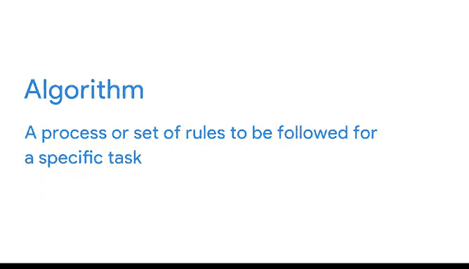
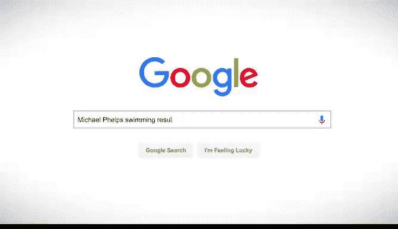
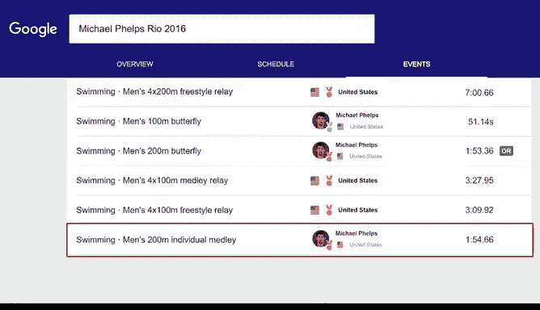
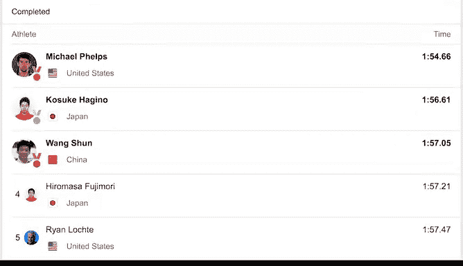

# 谷歌数据分析师第二课《以数据驱动的决策提出问题》ask-questions-make-decisions - P10：10_02_02_数据如何赋能决策.zh_en - GPT中英字幕课程资源 - BV1RP411e7NV

We've talked a lot about what data is and how it plays into decision making。

 so what do we know already Well， we know that data is a collection of facts。

We also know that data analysis reveals important patterns and insights about that data， and finally。

 we know that data analysis can help us make more informed decisions。

 Now we'll look at how data plays into the decision making process and take a quick look at differences between data driven and data inspired decisions。

 Let's look at a real life example。 Think about the last time you searched restaurants near me and sorted the results by rating to help you decide which one looked best。

 That was a decision you made using data Business and other organizations use data to make better decisions all the time。

 there's two ways they can do this with data driven or data inspired decision making We'll talk more about data inspired decision making later on。

 but here's a quick definition for now。 data inspired decision making explores different data sources to find out what they have in common。

Here at Google we use data every single day in very surprising ways too， for example。

 we use data to help cut back on the amount of energy spent cooling our data centers after analyzing years of data collected with artificial intelligence。

 we were able to make decisions that help reduce the energy we use to cool our data centers by over 40%。

Google's people Op team also uses this data to improve how we hire new Googlers and how we get them started on the right foot we wanted to make sure we weren't passing over any talented applicants and that we made their transition into their new rules as smooth as possible so after analyzing data on applications。

 interviews and new hire orientation processes， we started using an algorithm。

 an algorithm is a process or set of rules to be followed for specific task。

With this algorithm， we reviewed applicants that didn't pass the initial screening process to find great candidates data also helped us determine the ideal number of interviews that lead to the best possible hiring decisions。

 and we've created new onboarding agendas to help new employees get started at their new jobs data is everywhere。

😊，Today， we create so much data that scientists estimate 90% of the world's data has been created in just the last few years。

 Think of the potential here。 The more data we have。

 the bigger the problems we can solve and the more powerful our solutions can be。

 but responsibly gathering data is only part of the process。

 We also have to turn data into knowledge that helps us make better solutions。

 I'm going to let fellow Google Ed talk more about that。😊，Just having tons of data isn't enough。

We have to do something meaningful with it。Data in itself provides little value。To quote Jack Dorsey。

 the founder of Twitter and Square。

Every single action that we do in this world is triggering off some amount of data。

And most of that data is meaningless until someone adds some interpretation of it。

 or someone adds a narrative around it。Data is straightforward。

Facts collected together， values that describe something。

Individual data points become more useful when they're collected and structured。

 but they're still somewhat meaningless by themselves。

We need to interpret data to turn it into information。

Look at Michael Phelps's time in a 200 meter individual medley swimming race， one minute。

 54 seconds doesn't tell us much。

When we compare it to his competitor' times in the race， however。

 we can see that Michael came in first place and won the gold medal。

Our analysis took data， in this case， a list of Michael's races and times and turned it into information by comparing it with other data。

Context is important we needed to know that this race was an Olympic final and not some other random race to determine that this was a gold medal finish。

But this still isn't knowledge。When we consume information， understand it and apply it。

 that's when data is most useful。 In other words， Michael Phelps is a fast swimmer。

It's pretty cool how we can turn data into knowledge that helps us in all kinds of ways。

 whether it's finding the perfect restaurant or making environmentally friendly changes。😊。

But keep in mind， there are limitations to data analytics。

 Sometimes we don't have access to all of the data we need。

Or data is measured differently across programs， which can make it difficult to find concrete examples。

We'll cover these more in details later on， but it's important to start thinking about them now。

Now that you know how data drives decision making， you know how key your role as a data analyst is to the business。

 data is a powerful tool for decision making and you can help provide businesses with the information they need to solve problems and make new decisions。

 but before that， you will need to learn a little more about the kinds of data you'll be working with and how to deal with it。

