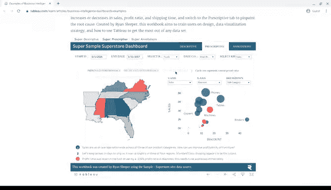

# 谷歌数据分析师第二课《以数据驱动的决策提出问题》ask-questions-make-decisions - P12：12_02_01_成果展示-分享你的发现.zh_en - GPT中英字幕课程资源 - BV1RP411e7NV

Data is great， but if we can't communicate the story data is telling， it isn't useful to anyone。

 so we need ways to organize data that helps us turn it into information。

 There are all kinds of tools out there to help you visualize and share your data analysis with stakeholders here we'll talk about two kinds of data presentation tools。

 reports and dashboards。😊，Reports and dashboards are both useful for data visualization。

 but there are pros and cons for each of them。 A report is a static collection of data given to stakeholders periodically。

 a dashboard， on the other hand， monitorits live incoming data。 Let's talk about reports first。

 Report are great forgiving snapshots of high level historical data for an organization。 For example。

 a finance firm's monthly sales。 Report come with a lot of benefits。 too。

 they can be designed and send out periodically， often on a weekly or monthly basis。

 as organized and easy to reference information。 They're quick to design an easy to use。

 as long as you continually maintain them。 And finally。

 because reports use static data or data that doesn't change once it's been recorded。

 They reflect data that's already been cleaned and sorted。😊，There are some downsides to keep in mind。

 too。 Reports need regular maintenance and aren't very visually appealing。

 And because they aren't automatic or dynamic， Report don't show live evolving data。

 for a live reflection of incoming data， you'll want to design a dashboard。

 Dashboards are great for a lot of reasons。 They give your team more access to information being recorded。

 you can interact the data by playing with filters。 And because they're dynamic。

 they have long term value。 if stakeholders need to continually access information。

 a dashboard can be more efficient than having to pull reports over and over。

 which is a big time saver for you。 And last but not least， they're just nice to look at。

 but dashboards do have some cons， too。 For one thing。

 they take a lot of time to design and can actually be less efficient than reports。

 If they're not used very often。 And if the base table breaks at any point。

 they need a lot of maintenance。😊，To get back up and running again。

Dashboards can sometimes overwhelm people with information， too。

 if you aren't used to looking through data on a dashboard， you might get lost in it。

As a data analyst， you need to decide the best way to communicate information to your stakeholders。

 For example， what if your stakeholders are interested in the company's social media engagement Would a monthly report that tells them the number of new followers for their page be useful。

Or a dashboard that monitors live social media engagement across multiple platforms。 Later on。

 you'll create your own reports and dashboards to practice using these tools。 But for now。

 I want to show you what a report and a dashboard might look like。

 We'll start by using a tool were already familiar with Spsheets。

 Let's see one way spreadsheet data could be visualized in a report。

 This spreadsheet has data set with order details from a whole company。 That's a lot of information。

 from the headers。 We can see different things recorded here， like the order date， the salesperson。

 the unit price and revenue for each transaction recorded。😊，It's all useful information。

 but a little hard to wrap your head around。 We want a report that's easier to read。

 Let's say your stakeholders want a quick look at the revenue by salesperson using the data。

 you could make them a pivot table with a graph that shows that information。😊。

A pivot table is a data summarization tool that is used in data processing。

 Pivot tables are used to summarize， sort， reorganize group， count。

 To or average data stored in a database It allows its users to transform columns into rows and rows into columns We actually learn more about pivot tables later。

 but I'll show you one really quick We'll select the data menu and click pivotvo table button。

 It can pull data from this table so we can just press create and it'll pull up a new worksheet over here it gives us the pivot table fields we can choose from。

😊，L select， salesperson and revenue。And just like that， it made a chart for us at this point。

 you can play around with how the graph looks， but the information is all there。 Allright。

 let's move on to dashboards。 If you need a more dynamic way to share information with your stakeholders。

 Dashboards are your friend You might create something like this tableableau dashboard with interactive graphs that showcase multiple views of the data with this users can change location date range or any other aspect of the data they're viewing by clicking through different elements on the dashboard pretty cool right later in this program we'll look into how you can make your own data visualizations We have a lot to learn before we get to that。

 but I hope this was an exciting first peak at the different visualization tools。

 you'll be using as a data analyst。😊。

