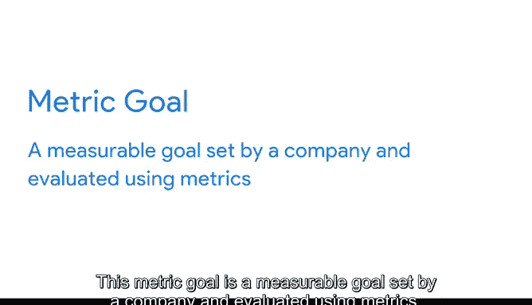

# 谷歌数据分析师第二课《以数据驱动的决策提出问题》ask-questions-make-decisions - P13：13_02_02_数据与指标对比.zh_en - GPT中英字幕课程资源 - BV1RP411e7NV

In the last video we learned how you can visualize your data using reports and dashboards to show off your findings in interesting ways in one of our examples。

 the company wanted to see the sales revenue of each salesperson that specific measurement of data is done using metrics。

Now I want to tell you a little bit more about the difference between data and metrics and how metrics can be used to turn data into useful information。

😊，A metric is a single quantifiable type of data that can be used for measurement。

Think of it this way， data starts as a collection of raw facts until we organize them into individual metrics that represent a single type of data。

Metrics can also be combined into formulas that you can plug your numerical data into。

In our earlier sales revenue example， all that data doesn't mean much unless we use that specific metric to organize it。

So let's use revenue by individual salesperson as our metric Now we can see who sales brought in the highest revenue metricss usually involve simple math revenueevenue。

 for example， is the number of sales multiplied by the sales price。Chsing the right metric is key。

Data contains a lot of raw details about the problem we're exploring。

 but we need the right metrics to get the answers we're looking forDifferent industries will use all kinds of metrics to measure things in a data set。

Let's look at some more ways businesses in different industries use metrics。

 so you can see how you might apply metrics to your collected data。Ever heard of ROI？

Companies use this metric all the time ROI or return on investment is essentially a formula designed using metrics that let a business know how well an investment is doing the ROI is made up of two metrics the net profit over a period of time and the cost of investment by comparing these two metrics。

 profit and cost of investment the company can analyze the data they have to see how well their investment is doing this can then help them decide how to invest in the future and which investment to prioritize。

We see metrics used in marketing too， for example， metrics can be used to help calculate customer retention rates or a company's ability to keep its customers over time。

Customer retention rates can help the company compare the number of customers at the beginning and the end of a period to see their retention rates。

This way， the company knows how successful their marketing strategies are and if they need to research new approaches to bring back more repeat customers。

Different industries use all kinds of different metrics。

 but there's one thing they all have in common， they're all trying to meet a specific goal by measuring data this metric goal is a measurable goal set by a company and evaluated using metrics and just like there are a lot of possible metrics there are lots of possible goals too。

Maybe an organization wants to meet a certain number of monthly sales。

 or maybe a certain percentage of repeat customers。

By using metrics to focus on individual aspects of your data。

 you can start to see the story your data is telling。

Metric goals and formulas are great ways to measure and understand data。

 but they're not the only ways we'll talk more about how to interpret and understand data throughout this course。

