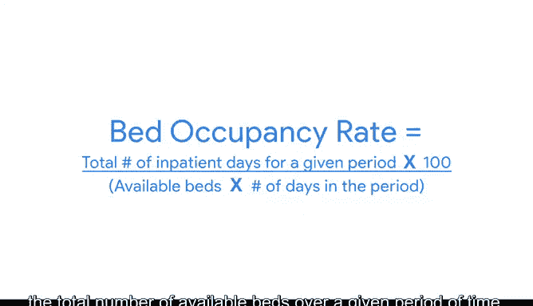

# 谷歌数据分析师第二课《以数据驱动的决策提出问题》ask-questions-make-decisions - P14：14_02_01_数学思维.zh_en - GPT中英字幕课程资源 - BV1RP411e7NV

So far you've learned a lot about how to think like a data analyst we've explored a few different ways of thinking and now I want to take that one step further by using a mathematical approach to problem solving mathematical thinking is a powerful skill you can use to help you solve problems and seeing new solutions so let's take some time to talk about what mathematical thinking is and how you can start using it using the mathematical approach doesn't mean you have to suddenly become a mathwiz it means looking at a problem and logically breaking it down step by step so you can see the relationship of patterns in your data and use that to analyze your problem。

This kind of thinking can also help you figure out the best tools for analysis because it lets you see the different aspects of a problem and choose the best logical approach there's a lot of factors to consider when choosing the most helpful tool for your analysis。

One way you could decide which tool to use is by the size of your data when working with data。

 you'll find that there's big and small data， small data can be really small。

 these kinds of data tend to be made up of datas concerned with specific metrics over a short。

 well definedfined period of time， like how much water you drink in a day。

Small data can be useful for making day to day decisions like deciding to drink more water。

 but it doesn't have a huge impact on bigger frameworks like business operations you might use spreadsheets to organize and analyze smaller data sets when you first start out big data on the other hand has larger。

 less specific data sets covering a longer period of time。

They usually have to be broken down to be analyzed Big data is useful for looking at large scale questions and problems。

 and they help companies make big decisions when you're working with data on this larger scale you might switch to SQL。

 Let's look at an example of how a data analyst working in a hospital might use mathematical thinking to solve a problem with the right tools The hospital might find that they are having a problem with over or under use of their beds based on that the hospital could make bed optimization a goal they want to make sure that beds are available to patients who need them but not waste hospital resources like space or money on maintaining empty beds。

Using mathematical thinking， you can break this problem down into a step by step process to help you find patterns in their data。

There's a lot of  variables in this scenario， but for now let's keep it simple and focus on just a few key ones。

There are metrics that are related to this problem that might show us pattern in the data。

 for example， maybe the number of bes open and the number of bes used over a period of time。

There's actually already a formula for this， it's called the bed occupancy rate and it's calculated using the total number of inpatient days and the total number of available beds over a given period of time。

What we want to do now is take our key variables and see how their relationship to each other might show us patterns that can help the hospital make a decision。

To do that， we have to choose the tool that makes sense for this task。

Hospitals generate a lot of patient data over a long period of time。

 so logically a tool that's capable of handing big data sets is a must SQL is a great choice。

 In this case you' discovered that the hospital always has unused beds knowing that they can choose to get rid of some beds which saves them space and money that they can use to buy and store protective equipment by considering all of the individual parts of this problem logically mathematical thinking helped us see new perspective that led us to a solution。

 Well， that's it for now， great job。 you've covered a lot of material already。

 you've learned about how empowering data can be in decision making the difference between quantitative and qualitative analysis using reports and dashboards for data visualization metrics and using a mathematical approach to problem solving Com up next we'll be tackling spreadsheet basics get。

To put what you've learned into action and learn a new tool to help you along the data analysis process。

 see you soon。