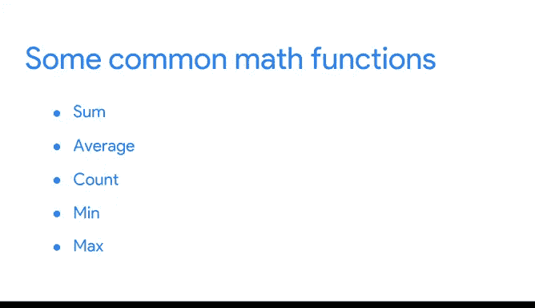

# 谷歌数据分析师第二课《以数据驱动的决策提出问题》ask-questions-make-decisions - P15：15_03_01_强大的电子表格.zh_en - GPT中英字幕课程资源 - BV1RP411e7NV

Hi again I'm glad you're back in this part of the program we'll revisit the spreadsheet spreadsheets are a powerful and versatile tool。

 which is why they're a big part of pretty much everything we do as data analysts there's a good chance a spreadsheet will be the first tool you reach for when trying to answer datadri questions。

So after you've defined what you need to do with the data。

 you'll turn to spreadsheets to help build evidence that you can then visualize and use to support your findings Spsheets are often the unsung heroes of the data world they don't always get the appreciation they deserve but as a data detective you'll definitely want them in your evidence collection kit I know spreadsheets have saved the day for me more than once I've added that data for purchase orders into a sheet set up formulas in one tab and had the same formulas do the work for me in other taps This frees up time for me to work on other things during the day I couldn't imagine not using spreadsheets math is a core part of every data analyst job but not every analyst enjoys it luckily spreadsheets can make calculations more enjoyable and by that I mean easier let's see how。

Spreadsheets can do both basic and complex calculations automatically。

 not only does this help you work more efficiently。

 but it also lets you see the results and understand how you got them here's a quick look at some of the functions that you'll use when performing calculations。

Many functions can be used as part of a math formula as well。

Functions and formulas also have other uses and we'll take a look at those two we'll take things one step further with exercises that use real data from databases This is your chance to reorganize a spreadsheet。

 do some actual data analysis and have some fun with data。

