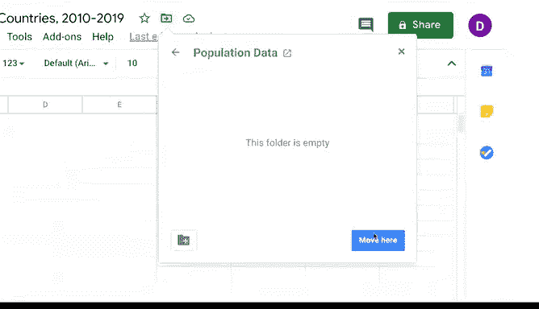

# 谷歌数据分析师第二课《以数据驱动的决策提出问题》ask-questions-make-decisions - P17：17_03_05_基础电子表格操作.zh_en - GPT中英字幕课程资源 - BV1RP411e7NV

We've talked about how spreadsheets are great for organizing data and performing calculations now it's time to get our hands dirty and start building a real spreadsheet。

In this video， I'm going to demonstrate some basic tasks we know data analyst use spreadsheets for。

Including entering and organizing data， we'll start with a step by step process to show you some tools to organize your data in a spreadsheet。

Consider these steps the basics， you won't always have to use them when working with a data set。

 but if your data is a bit messy when you get it， these steps can help you get it ready for analysis。

 Let's start by opening a new spreadsheet As a data analyst。

 you might not start with a blank spreadsheet， but it's good to know how to do it just in case。

Start by opening Excel， Google sheetets or whatever spreadsheet software you're using。

 Then select a new blank file。 The first thing you'll want to do when you open a new spreadsheet is give it a title。

 Here's a pro tip。 Make your title short。 clear and have it state exactly what the data in this spreadsheet is about。

 Trust me， it'll make searching for it a lot easier。

Creating a folder on your computer specifically for spreadsheets and related files can also make it easier to find them for this spreadsheet。

 it's already saved in our drive so we'll open our file menu to click moveve。

Then we'll create a new folder。Name it， population data。And move the spreadsheet there。

Our spreadsheet now has a new home。 This will save you a lot of unnecessary clicks and headaches when you look for this file。

 There's a few different ways data analysts get data they work with， depending on the job。

 you might use data from an open source。 You might be given data to work with。

 or you might be asked to find your own data。 You'll experience all of these later in the program。

 There's a lot of open data sources online where data is made available to the public。 For example。

 we'll use data from Worldbank do org。 That's already in a spreadsheet。

 The data shows the population of Latin American and Caribbean countries from 2010 through 2019。

 Let's open this spreadsheet。😊，Okay， time to get the data ready for analysis。

 we'll start by selecting the whole sheet。And making our columns wider by dragging the boundary of one of the columns。

This will help us see the data clearly， then we can adjust any individual columns that need it。

 you can make columns wider in other ways as well but this will work for now。

The first row of spreadsheet is for data attributes or variables。

 so it's basically labeling the type of data in each column。

 Let's make the attribute stand out from the rest of the rows by selecting it and filling it with color。

We'll also make the labels bold。If we want to add another data attribute between two of the other attributes。

 we can always add a new column。Just click on any cell within a column and use the insertt menu to add a new one。

It will appear next to the column you originally clicked， pretty simple， right？

Deleting a column is just as simple to delete， right click in a cell in the column you want to get rid of。

The steps we're showing may be different depending on the spreadsheet program you're using。

 but should be pretty similar， let's add one more thing to our data table borderors。

 this can help you see each piece of data more clearly to add border start by clicking the select Alpa and at the top left corner of your spreadsheet。

This is kind of like a magic button because you can click it whenever you need to make changes to every cell in your spreadsheet。

 then click the border button in the menu and choose the type of borders you want。

To keep our spreadsheets uniform， we'll choose borders for all cells。And just like that。

 we've gone from rock to refined Now our spreadsheet is filled with data and it's nice to look at too using these organization tools before you analyze can help you focus on the data once you start your analysis Now that we've gone over some ways spreadsheets can be used to organize data。

 you're ready to start working on them yourself Later， you'll learn more about spreadsheets。

 including some common errors and how to fix them。