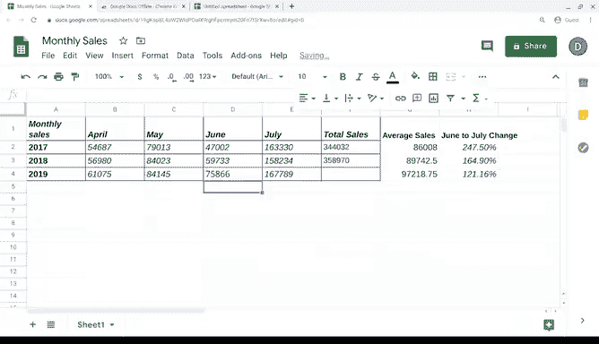

# 谷歌数据分析师第二课《以数据驱动的决策提出问题》ask-questions-make-decisions - P18：18_03_02_成功公式.zh_en - GPT中英字幕课程资源 - BV1RP411e7NV

So far， we've covered how to start a new spreadsheet。

 enter in data and make it look refined and ready for some serious analysis。

 Now we'll learn how to perform calculations in your spreadsheet。

 You may need to calculate everything from sums to averages to finding minimums and maximum amounts。

 you'll use calculations for a lot of different kinds of tasks。

 So in this video we' focus on learning the basics and then do a little math with some sales data to practice。

 Let's talk about formulas first。 You might remember that a formula is a set of instructions that perform a specific calculation。

😊，Basically， formulas can do the math for you。 Now they don't only do math。 they can do a lot more。

 and soon you'll learn different ways you can use them throughout the data analysis processes。

Formulas are built on operators， which are symbols that name the type of operation or calculation to be performed。

 For example， a plus sign is a common operator。 The formulas you use as a data analyst will usually include at least one operator。

 Now， let's talk about math expressions or equations。 These can take a lot of different forms。

 but you might be familiar with them already，3-1，15 plus 8 divided by 2，846 times 513。

 These are all examples of expressions。 Is this bringing back memories of grade school。😊，Well。

 back in math class， you most likely learn to complete an expression by including an equal sign and the solution。

 it's slightly different with spreadsheets when you create a formula using an expression in a spreadsheet。

 you start the formula with an equal sign， for example， if we want to subtract。

 we type an equal sign followed by the rest of the expression without any spaces in the formula。

Now let's try an expression that's a bit more challenging， we type。3，1，9，8，2。

Then a hyphen4 minus sign。Then 1，7，7，9，5。And to calculate， we press enter。

You'll most likely use formulas this way when dealing with large numbers or expressions with multiple steps。

Here are the operators you'll use to complete formulas， the plus sign for addition。

 the minus or hyphen for subtraction， the asterisk for multiplication and the forward flash for division。

 The division and multiplication symbols might be different than what you're used to。

 Small changes but important to keep in mind。 If you already have data in your spreadsheet。

 you can use cell references in your formulas instead。

 a cell reference is a single cell or range of cells in a worksheet that can be used in a formula。

 cell references contain the letter of the column and the number of the row where the data is。

 A range of cells as a collection of two or more cells。

 a range can include cells from the same row or column or from different columns and rows collected together。

 will show you an example in an upcoming video。 Now。

 let's apply what we just learned to some sales data。

 If we want to add these figures to find the total sales for the first row of data。

 you can click cell F2。😊，Yeah。From there， we'll start with an equal sign。

And use the cell references to input values in your expression。

We're starting with cell B2 because the year in A2 is not a value we want to add to the total。

Then press enter， and just like that， your total sales has been calculated for you。

But what if you realized one of the values in your data was wrong， No problem。

 You can change the value in any cell use in the formula and the total will update automatically。

The great thing about using cell references is that they also automatically update when a formula is copied to a new cell。

 talk about a time saver， so instead of entering the same formula again for every new set of cell references。

 just copy the formula using the menu or a keyboardword shortcut like control+ C。

Then paste the formula where you want to apply it using control+ v。And Presto。

 the formula updates all the new cells and values correctly。 Now。

 let's say you also wanted to find the average sales for this。

 you create a new formula in a different cell。To group values in a formula use parentheses。

 this lets your spreadsheet know which values to calculate together and the order of the operations to be performed。

 for example， open parentheses。Then， B2。Plus， C2。Plus， D2。Plus， E2。And close parentheses。

 then divide the value of all of this by4 by typing s 4。

So you are adding the values in the four cells together and then using the slash to divide the total by four。

 and just like the last one， we can copy and paste the formula。

Here's another formula you can use if you want to find the percent change in sales between June and July。

Once the formula calculates the value， you can then use the percent button to change the value to a percentage。

When you apply the formula to the other rows， both the formula and the percent will automatically update。

Oh oh， that doesn't look like the right answer。 Looks like we've got an error。 Don't worry。

 errorsors can happen at any stage of data analysis。

 and that includes when you're using spreadsheets， a formula has to be airtight。

 if there's something wrong with one of the cell references it won't work So what's our error。

 Well we can see that the value in cell D4 is missing。

It might take some time and research on your part to find the correct value。

 but it's worth it you want your analysis to be as accurate as possible when you do add the value the formula takes care of the rest。

That was a lot to take in。 Thanks for staying with me。

 You'll be able to apply what you learned about formulas here and later in the program to make your analysis more efficient and your job a little easier。

 and soon you'll work in your own spreadsheet。 Happy spreadsheing。😊。

