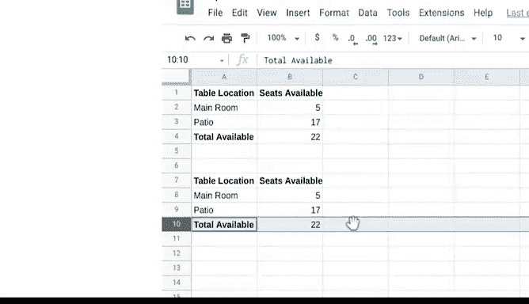

# 谷歌数据分析师第二课《以数据驱动的决策提出问题》ask-questions-make-decisions - P19：19_03_04_电子表格错误与修复.zh_en - GPT中英字幕课程资源 - BV1RP411e7NV

Hi， and welcome back。Recently， we've been learning about formulas。

 Sometimes data analysts encounter a problem with our formulas， and we get an error。

 We've all been there， and it can be frustrating， but there are solutions。

 That's what we're going to explore in this video。 One error you may encounter is the div error。

 The div error happens when a formula trying to divide a value in a cell by 0 or by an empty cell。😊。

In this spreadsheet， the percentage complete values in column C are calculated by dividing the values in the task completed column by the values in the required tasks column。

 noticeice that column C is already formatted as a percentage。

The div error is in cell c4 because we're dividing by0， the value in cell A4。To avoid this problem。

 we can have the spreadsheet automatically enter， not applicable wheneverever a cell in column A contains a0 that would cost the error。

To do this we'll use the if error function。 If it encounters a if error caused by a cell that contains a0。

 the phrase not applicable will be inserted。We can also copy the formula to the rest of the cells in column C。

 so it checks for any other cells that contain a zero。Now let's move on to error In Google Sheets。

 error tells us the formula can't be interpreted as it is input。

This is also known as a parsing error。Say we want to tally the number of total tasks in column B and C。

 we use the sum function。But the formula equals sum B2 to B 6， C2 to C 6 causes an error。

Examining it more closely， we see that a comma is missing between the cell ranges B2 to B6 and C2 to C6。

 we can fix this by insert a comma between the cell ranges to indicate the end of each data item。

This is called a delimiter， which you will learn more about soon。Now。

 the formula can correctly calculate the total number of tasks as 25。All right。

 another type of error is N slash A。The N slash A error tells you that the data in your formula can't be found by the spreadsheet。

Generally， this means the data doesn't exist。 This error most often occurs when using functions such as V lookup。

 which searches for a certain value in a column to return a corresponding piece of information Here。

 we see a master list of nuts and their prices using V lookup。

 the spreadsheet finds prices in the list。 Then calculates the prices for each store using the assigned markup。

 but we have an n slash a error in sells B49 and C 49。 The V lookup formula is correct。

 So what's going on。Well， if we look carefully at the name of the net。

 almond has no match in the lookup table。 The lookup table uses the plural almonds， instead。

So we change almond to almonds， and with thattypo fixed， the right prices are filled in。

And speaking of typos， sometimes a typo can cause a name error。

 a name error can happen when a formula's name isn't recognized or understood。

Suppose we see a name error in the nett prices spreadsheet。 If we look carefully。

 the V look at function and sell B21 is spellt incorrectly。 It has one extra O。

 This causes a name error for both the price and the resulting mark up calculation for the store。😊。

To fix this error， we can delete the extra O and Vlookup。Perfect。

Sometimes an error is caused by inconsistent or wrong data。 For instance。

 the numb error tells us that a formula calculation can't be performed as specified by the data。

The data doesn't make sense for that calculation。Here's what I mean。

 Suppose we're working on a large construction project and using a spreadsheet to track how many months it takes to reach key milestones。

We can use the date di function to calculate the number of months between start and end dates。

The function requires a start date to be in the first cell referenced and the end date to be in the second cell referenced。

 In our case， cells B2 and C2 respectively。And the M represents months as we want the spreadsheet to calculate the number of months between our start and end dates。

 But we get a numb error in cell D 6。 We notice that the end date comes before the start date。

 so the date if function can't calculate the number of months between。

It's likely the start and end dates were interchanged by accident。

 We can request verification of the data to make sure in the meantime。

 let's reverse the order of the cells in the formula to temporarily get around the error。Now。

 the result is nine months。What if the client's name was accidentally inserted into the start date in the spreadsheet？

You guesseded。 We get an error。 The value error can indicate a problem with a formula or reference cells。

 It's often not clear right away what the problem is。

 So this error might take a little more effort to fix。 In this case。

 John Wety was input as a start date。 making the calculation impossible for the date to function in the cell D 6。

So we just replaced the tax John Wety with the correct start date of September 1，2016。O。

 last is the ref error， which often comes up when cells being referenced in a formula have been deleted。

 thus， making the formula unable to perform the calculation。

Heres a spreadsheet used to calculate the number of seats available for a company lunch。

Let's say the company decided not to run the second floor。

 so we delete row4 This results in a RE error when calculating the total seats available in cell B5。

To fix this， we can change the formula to add the values in cells B2 and B3。Also， in this case。

 we could have prevented the ref error by using the sum function and a range of cells instead of adding a cell value by direct reference。

Now， if we delete Ro 10， the sum function calculates the total seats available。And there you go。

 we've now fixed some of the most common spreadsheet errors。 When you see them again。

 you'll know what they mean。 Troubleshooting is a big part of data analysis。

 so being able to find solutions is a key skill for data analysts。

