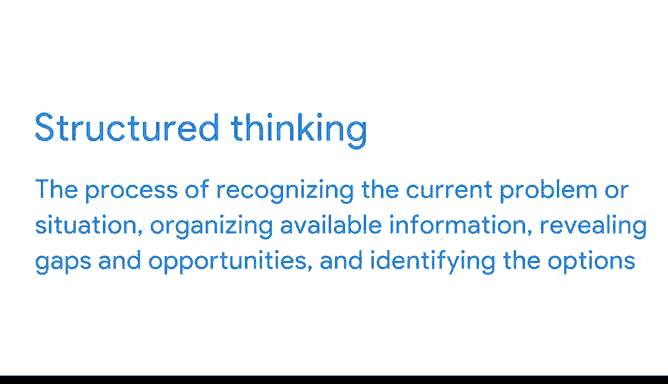

# 谷歌数据分析师第二课《以数据驱动的决策提出问题》ask-questions-make-decisions - P1：01_01_01_问题解决与有效提问入门.zh_en - GPT中英字幕课程资源 - BV1RP411e7NV

Welcome to the second course in the Google data Analytic certificate If you completed course1。

 we've met briefly at the beginning， but for those of you who are just joining us。

 my name is Humana and I'm a Google finance data analyst I think it's really wonderful that you're here with me learning about the fascinating field of data analytics Learn and education have always been very important to me When I was young。

 my mom always said I can't leave you an inheritance but I can give you an education that opens doors that always pushed me to keep learning and that education gave me the confidence to apply for my job at Google Now I get to do really meaningful work every day just recently I worked as an analyst on a team called Verily life sciences We were helping to get live-saving medical supplies to those who need it most to do this we forecasted what healthcare professionals would need on hand and then share that information with networks The information that my team provided helped。

Make data driven decisions that actually saved lives。

 I'm thrilled to be your instructor for this course。

 We're going to talk about the difference between effective and ineffective questions and learn how to ask great questions that lead to insights that can help you solve business problems。

 You will discover that effective questions help you to make the most of all the data analysis faces。

 You may remember that these faces include ask， prepare， process， analyze， share and act。😊。

In the ask step， we define the problem we're solving and make sure that we fully understand stakeholder expectations。

 this will help keep you focused on the actual problem which leads to more successful outcomes so we'll begin this course by talking about problem solving and some of the common types of business problems that data analysts help solve。

And because this course focuses on the ask phase， you'll learn how to craft effective questions that help you collect the right data to solve those problems。

🎼Next， we'll talk about the many different types of data。

 You'll learn how and when each is the most useful。

 You'll also get a chance to explore spreadsheets further and discover how they can help make your data analysis even more effective。

 and then we'll start learning about structure thinking。

 structure thinking is the process of recognizing the current problem or situation。

 organizing available information， revealing gaps and opportunities and identifying the options。

 In this process， you address a very complex problem by breaking it down into smaller steps。

 And then those steps lead you to a logical solution。

 We'll work together to be sure you fully understand how to use structure thinking and data analysis。

 Finally， we'll learn some proven strategies for communicating with others effectively。

 I can't wait to share more about my passion for data analytics with you so let's get started。😊。

