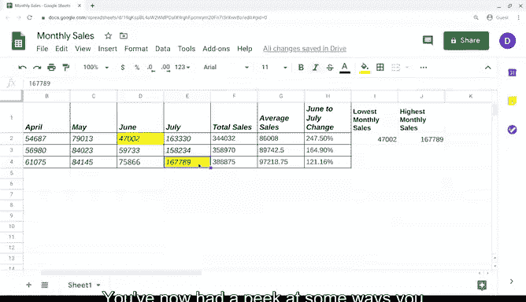

# 谷歌数据分析师第二课《以数据驱动的决策提出问题》ask-questions-make-decisions - P20：20_03_02_函数入门.zh_en - GPT中英字幕课程资源 - BV1RP411e7NV

Formulas are a great way to become more efficient when using spreadsheets。

 especially when you add shortcuts， like copying and pasting into the mix。

 as you progress as a data analyst， you'll most likely learn more shortcuts to help your process。

 but now it's time to move on to functions while they're closely related to formulas。

 they're not exactly the same By the end of this video。

 you'll understand the difference and know when to use them both。😊，In the world of spreadsheets。

 a function is a preset command that automatically performs a specific process or task using the data。

 You might remember some of the shortcuts we learned that can be used with formulas。

 Think of functions as the most useful of these shortcuts。

 The good news is a lot of spreadsheet functions have names that tell you what they do。

 There are tons of functions out there。 And as you continue to work with spreadsheets。

 you'll find that you use certain ones a lot。 and others rarely or not at all。 For now。

 let's take a look at some of the functions that we can apply to our sales data from the previous video。

 we'll start with total sales。😊，Let's use the sum function for this in cell F2。

The first steps are pretty similar to what we did in the last video。 First。

 we'll select the cell where we want the calculation to appear。Type equals。

 then add the word sum as our function。One of the great things about functions is they don't always need operators like a plus sign for addition in this case。

 after the open parentheses， you can go ahead and select the range of cells you're adding。

A column between the cell references shows that you're using a range。 In this case。

 the range includes cells from the same row。 After the close parentheses， we press enter。

 and just like that， our total sales number appears。Just like the formula we used before。

 functions can be copied and pasted into other cells in the same column。

But let's undo that step so that you can see another way to copy a function or formula。

Spreadsheets have something called a fill handle。 It's a little box that appears in the lower right hand corner when you click on a cell。

 If you rest your cursor on the box， you can then drag the fill handle to the other boxes in the same row or column。

Any formula or function in that cell will automatically be added to the cells you fill。Plus。

 the fill handle will update the formula so the cell references match the row of the columns of the cells you fill。

This means the formula is calculated based on the data in each separate row or column。

Fillling won't work for every situation， but it's still a pretty great trick。

Now let's find the average sale for each month using the average function。

Different functions perform different calculations， but they work in the same way。Keep in mind。

 not every calculation you'll come across has its own function to help you， for example。

 to find the percent change in sales between June and July。

 you'd use the same formula you used in an earlier video。

Let's say you're asked to find the lowest monthly sales in this data set。

 There is a function for that。 It's called the Mintten function， which stands for minimum。

 Here's how it works。 Say you need to find the lowest monthly sales for the whole set。

All you have to do is set up the function。Then after the open parentheses。

 select the values from all three rows。This might be important information for your stakeholders。

 so let's add color to the cell with that value in your data set to make it stand out in this case click on cell D2。

And then fill color icon。Which looks like a paint can。Then choose a color， I'll use yellow here。

You can follow the same steps for the highest sales by using the。Wait for it。Max function。

Looks like we have an error message。 What could be wrong。Ah。

 we forgot to include an open parentheses after the function。No worries。 It's a quick fix。

But this is a good reminder to continually check the format of your functions and formulas as you use them we'll learn more about error messages and how to work with them later Okay。

 that's better。 Now we'll add color to the cell with the highest sales too。

This is just one way to highlight key data。 You'll find out about some others later。😊。

You've now had a peek at some ways you can add an organize data in its spreadsheet。

 You've also seen how powerful formulas and functions can be when applied to real world data As a data analyst。

 this is just the beginning of your experience with spreadsheets。

 You'll soon find out how much more spreadsheets have to offer。 In the meantime。

 you're free to practice some of these formulas functions and other processes on your own。

 It can be fun to experiment and see all that spreadsheets can do。 So。

 you'll switch from spreadsheets to structure thinking。

 The data analytics pieces are starting to fit together。 excitinging stuff is coming right up。

 So stick around。😊。