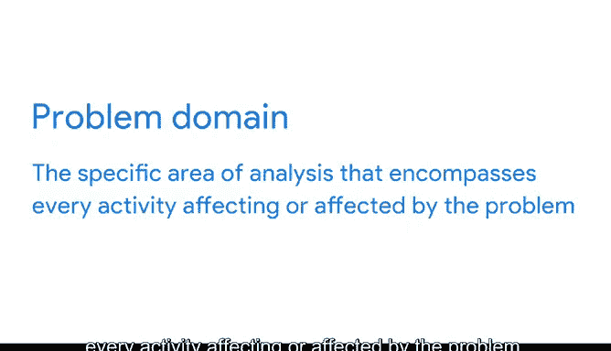

# 谷歌数据分析师第二课《以数据驱动的决策提出问题》ask-questions-make-decisions - P21：21_03_01_解决问题前先理解问题.zh_en - GPT中英字幕课程资源 - BV1RP411e7NV

Albert Einstein once said if I were given one hour to save the planet。

 I would spend 59 minutes defining the problem and one minute resolving it Now that might seem extreme。

 but it does show us just how important it is to define the problems before trying to solve them。

A lot of times teams jump right into data analysis before realizing a few months later that they are either solving the wrong problem or they don't have the right data in this video we will learn how to develop a structured approach to defining the problem domain this is important because if you define the problem clearly from the start。

 it'll be easier to solve which saves a lot of time。

 money and resources in the data world we call this first piece the problem domain。

 the specific area of analysis that encompasses every activity affecting or affected by the problem。

Before we can do anything else， we need to understand the problem domain and all of its parts and relationships so that we can discover the whole story actually calling it the first piece makes me think of a jigsaw puzzle say you have a puzzle Let's think of that puzzle as a problem domain you have all 500 pieces but you lost the box so you don't know what the image the puzzle will reveal。

Will it be an animal， a waterfall， a bowl of oranges？Whatever it is。

 it's going to be tough trying to put it together without an image you can refer to。

 even the greatest puzzler in the galaxy would need a new process and lots of time to complete that puzzle。

Data analysts face the same kinds of challenges too you might remember that data analysts aren't always giving the complete picture at the start of a project。

 a big part of their job is to develop a structured approach and use critical thinking to find the best solution。

 and that starts with understanding the problem domain。

This is where structure thinking comes into play。To successfully solve a problem as a data analyst。

 you need to train your brain to think structurally。And that's exactly what you'll learn coming up。

 see there。