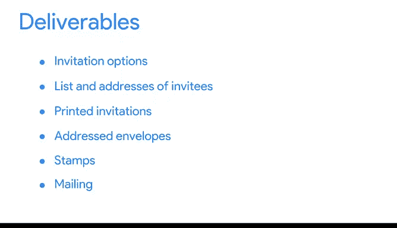

# 谷歌数据分析师第二课《以数据驱动的决策提出问题》ask-questions-make-decisions - P22：22_03_02_工作范围与结构化思维.zh_en - GPT中英字幕课程资源 - BV1RP411e7NV

So earlier I told you that carefully defining a business problem can ultimately save time。

 money and resources。 All of this is achieved through structure thinking structure thinking is the process of recognizing the current problem or situation。

 organizing available information revealing gaps and opportunities and identifying the options In other words。

 it's a way of being super prepared It's having a clear list of what you are expected to deliver a timeline for major tasks and activities and checkpoints so the team knows you're making progress。

😊，In this video， we'll look at how structure thinking helps to save time and effort。

 but also makes her job as data analyst easier because it allows us to better understand the work we are doing。

In the business world， it's common for teams to spend hours of valuable time trying to solve an important problem。

 only to end up back where they started， not only is the initial problem not resolved。

 but they've spent hours not resolving it This outcome negatively affects you。

 your team and the organization as a whole。But it can usually be prevented many times the situation as a result of not fully understanding the issue structureuc thinking will help you understand problems at a high level so that you can identify areas that need deeper investigation and understanding the starting place for structure thinking is the problem domain which you might have remembered from earlier once you know the specific area of analysis。

 you can set your base and lay out all your requirements and hypotheses before you start investigating with a solid base in place。

 you'll be ready to deal with any obstacles that come up。What kind of obstacles Well。

 let's say you're asked to predict the future value of an apartment building based on a given data you have hundreds of variables and everyone is crucial to your analysis but what if when variable accidentally gets left out like square footage for example。

 you'd have to go back and redo all your hard work That's because missing variables can lead to an accuratecur conclusions Another way that you can practice structure thinking and avoid mistakes is by using a scope of work A scope of work or SOW is an agreed upon outline of the work you're going to perform in a project for many businesses this includes things like work details schedules and reports that the client can expect Now as a data analyst your scope of work will be a bit more technical It include those basic items we just mentioned。

 but you'll also focus on things like data preparation validation。

Alysis of quantitative and qualitative data sets， initial results and maybe even some visuals to really get the point across let's bring a scope of work to life with a simple example。

 say a couple has hired a wedding planner will focus on just one task the wedding invitations here's what might be in scope of work。

Deliverables？Timeline。Milestones。And reports。Let's break down just one of these deliverables。

The wedding planner and couple will need to decide on the invitation。

 make a list of people to invite， collect their addresses， print the invitations。

 address the envelopes， stamp them and mail them out now let's check out the timelines you'll notice the dates and the milestones which keep us on track。

Finally， we have the reports which give our couple some peace of mind by telling them when each stop is complete a scope of work can be a simple but powerful tool with a solid scope of work you'll be able to address any confusion。

 contradictions or questions about the data up front and make sure these sneaky setbacks don't stand in your way this is a simple example of what a scope of work might look like。

 but later you'll be able to practice building your own。Next up in our scope。

 we'll check out setbacks from a different angle by learning the importance of contextualizing data and avoiding bias。

 looking forward to sharing some cool insights with you。

