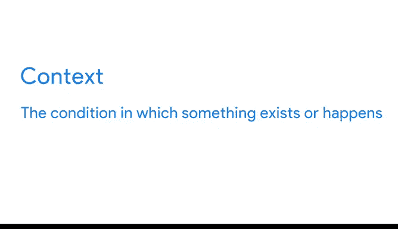
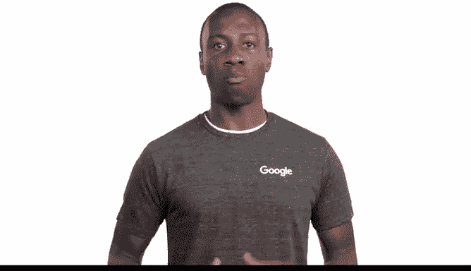
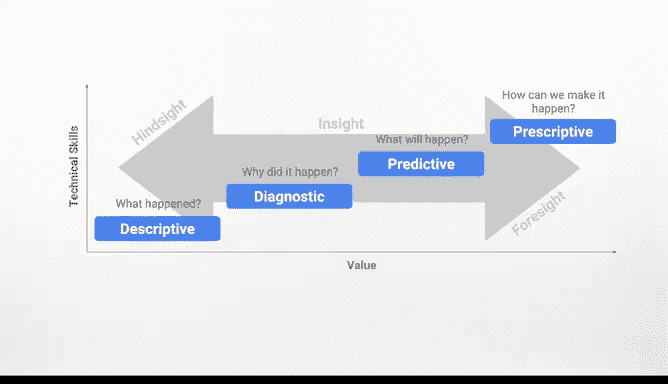

# 谷歌数据分析师第二课《以数据驱动的决策提出问题》ask-questions-make-decisions - P23：23_03_03_保持客观性.zh_en - GPT中英字幕课程资源 - BV1RP411e7NV

Welcome back in this video we'll explore the importance of contextualizing data and recognizing data bias。

 Let's get started。 data doesn't live in a vacuum in its context Earl we learned that context is the condition in which something exists or happens。

So actions can be appropriate in some context， but inappropriate in others。 For example。

 yelling move is rude in one context， Like if your friend is standing in front of the TV。

 but it's entirely appropriate in another。 Like， if that friend is about to get hit by a kid on a tricycle。

 Do you see the difference。😊。

In the world of data， numbers don't mean much without context。

 I'll let my fellow Googler Ed tell you a little bit more about that。

As we have more and more data available to us， we can leverage that data in increasingly sophisticated ways and generate more powerful insights from it。

We use data at many different levels。Sometimes our data is descriptive。

 answering questions like how much did we spend on travel last month？

Data becomes more valuable as we generate diagnostic and predictive insights。

 like understanding why travel spend increased last month。Data is most valuable however。

 when we can generate prescriptive insights， for example。

 how can we leverage data to incentivize more efficient travel？

Figuring out what data means is just as important as collecting it As a data analyst。

 a big part of your job is putting data into context。

 It's also up to you to remain objective and recognize all sides of an argument before drawing conclusions。

The thing about context is that it's very personal if two people curate the same data set and follow the same directions。

 there's a chance they will end up with different results。Why。

 because there is no universal set of contextual interpretations。

 everyone approaches it in their own way。And even if the data collection process is correct。

 the analysis can still be misinterpreted。Conclusions can be influenced by your own conscious and subconscious biases。

 which are based on cultural， social and market norms。 For example。

 if you ask a Boston resident which baseball team is the best。

 chances are they're going to say Boston Red So， which brings us to a major limitation of data analytics。

 If the analysis is not objective， the conclusions can be misleading。

To really understand what the data is about， you have to think through who， what， where， when， how。

 and why， it's good to ask yourself questions like who collected the data and what is it about。

What does the data represent in the world and how does it relate to other data？

When was the data collected， data collected a while ago may have certain limitations given the present day situation。

For example， if we collected phone numbers over the past century。

 at some point mobile phones would have been introduced。

 leading to the need for an additional phone number field。

You should also think about where was the data collected， a law can change across cities。

 states and countries， and how was it collected， a survey might not be as effective as an in- person interview for example。

 and of course there's the why， though why can have a particularly strong relationship with bias。

 why。Because sometimes data is collected or even made up to serve an agenda。

 the best thing you can do for the fairness and accuracy of your data is to make sure you start with an accurate representation of the population and collect the data in the most appropriate and objective way。

 then you'll have the facts that you can pass on to your team Hopefully you now understand the importance of fair and objective data and how important context is when it comes to understanding and interpreting it Next up。

 we'll figure out how we can bring it to life。