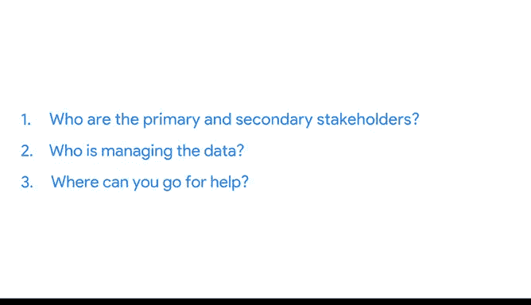

# 谷歌数据分析师第二课《以数据驱动的决策提出问题》ask-questions-make-decisions - P26：26_04_04_聚焦关键事项.zh_en - GPT中英字幕课程资源 - BV1RP411e7NV

So now that we know the importance of finding the balance across your stakeholders and your team members。

 I want to talk about the importance of staying focused on the objective。

 this can be tricky when you find yourself working with a lot of people with competing needs and opinions。

 but by asking yourself a few simple questions at the beginning of each task。

 you can ensure that you're able to stay focused on your objective while still balancing stakeholder needs。

Let's think about our employee turnover example from the last video。There。

 we were dealing with a lot of different team members and stakeholders like managers， administrators。

 even other analysts。As a data analyst， you'll find that balancing everyone's need can be a little chaotic sometimes。

 but part of your job is to look past the clutter and stay focused on the objective。

It's important to concentrate on what matters and not get distracted。As a data analyst。

 you could be working on multiple projects with lots of different people。

 but no matter what project you're working on， there are three things you can focus on that will help you stay on task。

 one who are the primary and secondary stakeholders。Two， who is managing the data？And three。

 where can you go for help？Let's see if we can apply those questions to our example project。

The first question you can ask is about who the stakeholders are。

 the primary stakeholder of this project is probably the vice president of HR who's hoping to use this project's findings to make new decisions about company policy。

You'd also be giving updates to your project manager。

 team members or other data analysts who are depending on your work for their own task。

These are your secondary stakeholders， take time at the beginning of every project to identify your stakeholders and their goals。

Then see who else is on your team and what their roles are Next。

 you'll want to ask who's managing the data For example。

 think about working with other analysts on this project your all data analyst。

 but you may manage different data within your project In our example。

 there was another data analyst who was focused on managing the company's hiring data Their insights around search and you hires 18 months ago turned out to be a key part of your analysis If you hadn't communicated with this person you might have spent a lot of time trying to collect or analyze hiring data yourself。

Or you may not have even been able to include it in your analysis at all， instead。

 you are able to communicate your objectives with another data analyst and use existing work to make your analysis richer。

😊，By understanding who's managing the data， you can spend your time more productively Next up。

 you need to know where you can go when you need help。

 This is something you should know at the beginning of any project you work on if you run into bumps in the road on your way to completing a task you need someone who is best positioned to take down those barriers for you when you know who's able to help you'll spend less time worrying about other aspects of the project and more time focused on the objective。

So who could you go to if you ran into a problem on this project Project manager support you and your work by managing the project timeline。

 providing guidance and resources and setting up efficient workflows they have a big picture view of the project because they know what you and the rest of the team are doing This makes them a great resource if you run into a problem in the employee turnover example。

 you would need to be able to access employee departure survey data to include in your analysis if you're having trouble getting approvals for that access you can speak with your project manager to remove those barriers for you so that you can move forward with your project your team depends on you to stay focused on your task so that as a team you can find solutions by asking yourself the easy questions at the beginning of new projects you'll be able to address stakeholder needs feel confident about who is managing the data and。

Hel when you need it so that you can keep your eyes on the price， the project objective。

So far， we've covered the importance of working effectively on a team while maintaining your focus on stakeholder needs Coming up。

 we'll go over some practical ways to become better communicators so that we can help make sure the team reaches its goals。

😊。