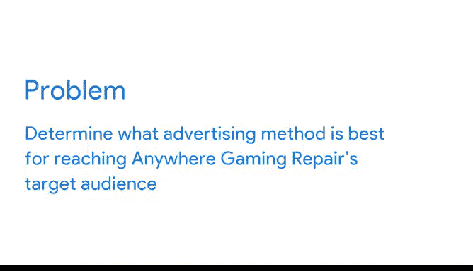

# 谷歌数据分析师第二课《以数据驱动的决策提出问题》ask-questions-make-decisions - P2：02_01_01_数据在行动中.zh_en - GPT中英字幕课程资源 - BV1RP411e7NV

In this video， I'm going to share an interesting data analytics case study。

 it will illustrate how problem solving relates to each phase of the data analysis process and shed some light on how these faces work in the real world。

It's about a small business that used data to solve a unique problem it was facing。

The business is called Anywhere Gaing repair， it's a service provider that comes to you to fix your broken video game systems or accessories。

The owner wanted to expand his business。 He knew advertising is a proven way to get more customers。

 but he wasn't sure where to start。 There are all kinds of different advertising strategies。

 including print， billboard， TV commercials， public transportation， podcast and radio。

 One of the key things to think about when choosing an advertising method， I your target audience。

 In other words， the specific people you're trying to reach。For example。

 if a medical equipment manufacturer wanted to reach doctors。

 pleasing an ad in a health magazine would be a smart choice。

 or if a catering company wanted to find new cooks。

 it might advertise using a poster at a bus stop near a cooking school。

Both of these are great ways to get your ads seen by your target audience the second thing to think about is your budget and how much the different advertising methods will cost。

😊，For instance， a TV ad is likely to be more expensive than a radio ad。

 a large billboard will probably cost more than a small poster on the back of a city bus。

The business owner asked a data analyst Maria， to make a recommendation。

 She started with the first step in the data analysis process， ask。😊。

Maria began by defining the problem that needed to be solved to do this。

 she first had to zoom out and look at the whole situation in context that way she could be sure that she was focusing on the real problem and not just his symptoms。

This leads us to another important part of the problem solving process。

 collaborating with stakeholders and understanding their needs。For anywhere gaming repair。

 stakeholders included the owner， the vice president of communications。

 and the director of marketinging and financein working together。

 Maria and the stakeholders agreed on the problem， not knowing their target audience's preferred type of advertising。

Next up was the prepare phase where Maria collected data for the upcoming analysis process。

 But first， she needed to better understand the company's target audience。

 People with video game systems。 After that， Maria collected data on the different advertising methods。

This way， she would be able to determine which was the most popular one with the company's target audience。

Then she moved on to the process step。Here， Maria cleaned the data to eliminate any errors or inaccuracies that could get in the way of the result。

As we've learned， when you clean data， you transform it into a more useful format。

 create more complete information， and remove outliers。Then it was time to analyze in this step。

 Maria wanted to find out two things。 First， who's most likely ton a video gaming system。 And second。

 where are these people most likely to see an advertisement。

Maria first discovered that people between the ages of 18 and 34 are most likely to make video game related purchases。

 so she could confirm that anywhere gaming repairs target audience was people 18 to 34 years old。

This was who they should be trying to reach With this in mind。

 Maria then learned that both TV commercials and podcasts are very popular with people in the target audience because Maria knew anywhere gaming repair had a limited budget and understanding the high cost of TV commercials。

 her recommendation was to advertise and podcasts because they are more cost effective。

Now that she had her analysis， it was time for Maria to share her recommendation so the company could make a data driven decision。

 She summarized her results using clear and compelling visuals of the analysis。

 This helped her stakeholders understand the solution to the original problem。 Finally。

 anywhere gaming repair took action。 They worked with a local podcast production agency to create a 32 ad about their services。

 The ad ran on podcast for a month， and it worked。 They saw an increase in customers after just the first week。

 By the end of week 4， they had 85 new customers。 There you go。 effectiveff problem solving。

 using data analysis， Phs in action。 Now， you've seen how the six phases of data analysis can be applied to problem solving。

 and how you can use that to solve real world problems。😊。

