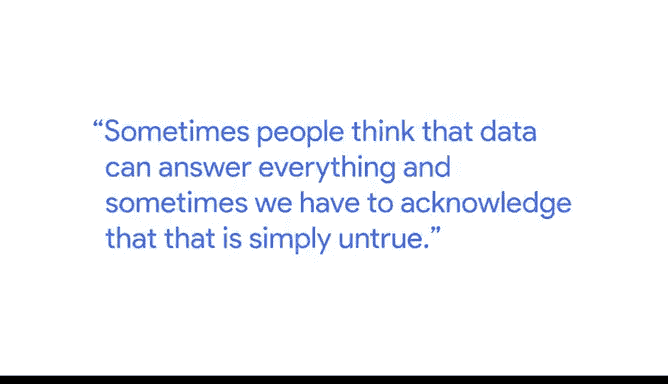
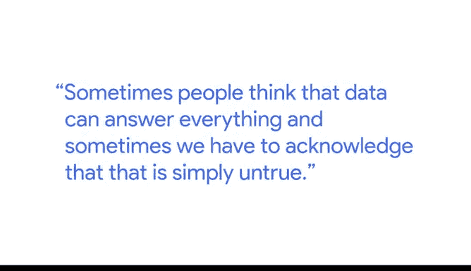

# 谷歌数据分析师第二课《以数据驱动的决策提出问题》ask-questions-make-decisions - P30：30_04_05_Sarah-如何与利益相关者沟通.zh_en - GPT中英字幕课程资源 - BV1RP411e7NV

I'm Sarah and I'm a senior analytical lead at Google as a data analyst。

 there's going to be times where you have different stakeholders who have no idea about the amount of time that it takes you to do each project and in the very beginning when I'm asked to do a project or to look into something I always try to give a little bit of expectation settings on the turnaround because most of your stakeholders don't really understand what you do with data and how you get it and how you clean it and put together the story behind it。

 the other thing that I want to make clear to everyone is that you have to make sure that the data tells you the stories Sometimes people think that data can answer everything and sometimes we have to acknowledge that that is simply untrue。

I recently worked with a state to figure out why people weren't signing up for the benefits that they needed and deserved。

 We saw people coming to the site。And where they would sign up for those benefits and see if they're qualified。

 But for some reason， there there was something stopping them from taking the step of actually signing up。

 So I was able to look into it using Google Analytics to try to uncover what is stopping people from taking the action of signing up from these benefits that they need and deserve。

 And so I go into Google Analytics。 I see people are going back between the service page and the unemployment page back to the service page back to the unemployment page And so I came up with a theory that。

 hey people aren't finding the information that they need。

 in order to take the next step to see if they qualify for these services the only way that I can actually know why someone left the site without taking action is if I ask them。

 I would have to survey them。 Google Analytics did not give me the data that I would need to 100% back my theory or deny it。

 So when you're explaining to your stake。😊， hey， I have a theory。 This data is telling me a story。

 However， I can't 100% know due to the limitations of data。 You just have to say it。

 So the way that I communicate that is I say I have a theory that people are not finding the information that they need in order to take action。

 Here's the proof points that I have that supports that theory。

 So what we did was we then made it a little bit easier to find that information。

 even though we weren't 100% sure that my theory was correct。

 we were confident enough to take action。 And then we looked back and we saw all the metrics that pointed me to this theory improve。

 And so that always feels really good when you're able to help a cause that you believe in do better and help more people through data。

 it makes all the nerdy learning about SQL and everything completely worth it。

