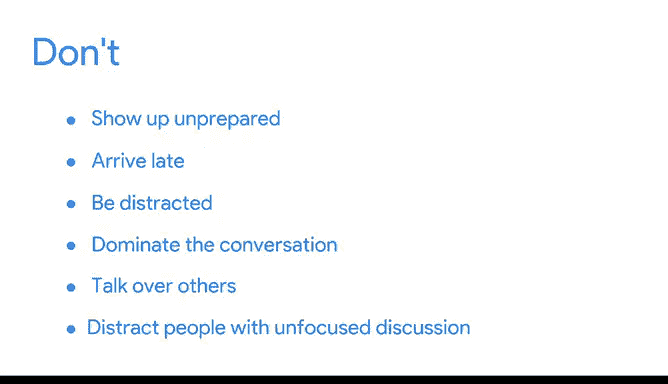

# 谷歌数据分析师第二课《以数据驱动的决策提出问题》ask-questions-make-decisions - P33：33_04_01_会议最佳实践.zh_en - GPT中英字幕课程资源 - BV1RP411e7NV

Now， it's time to discuss meetings。 Meings are a huge part of how you communicate with team members and stakeholders。

 Let's cover some easy to follow do's and don'ts you can use for meetings。

 both in person or online so that you can use these communication best practices in the future。😊。

At their core， meetings make it possible for you and your team members or stakeholders to discuss how a project is going。

 but they can be so much more than that。 whether they're virtual or in person。

 team meetings can build trust and team spirit。 They give you a chance to connect with the people you are working with beyond emails。

Another benefit is that knowing who you are working with can give you a better perspective of where your work fits into the larger project。

Regular meetings also make it easier to coordinate team goals。

 which makes it easier to reach your objectives。 And with everyone on the same page。

 your team will be in the best position to help each other when you run into problems， too。

So whether you're leading a meeting or just attending it。

 there are best practices you can follow to make sure your meetings are a success。

 There are some really simple things you can do to make a great meeting。😊，Come prepared。 be on time。

 Pay attention and ask questions。 This applies to both meetings you lead and once you attend。

 Let's break down how you can follow these two dos for every meeting。

So what do I mean when I say come prepared。 Well， a few things。 First。

 bring what you need If you like to take notes， have your notebook and pens in your back or your work device on hand。

 Being prepared also means you should read the meeting agenda ahead of time and be ready to provide any updates on your work。

 If you' are leading the meeting。 make sure to prepare your notes and presentations and know what you're going to talk about。

 And， of course， be ready to answer questions。 These are some other tips that I like to follow when I'm leading a meeting。

😊，First， every meeting should focus on making a clear decision and include the person needed to make that decision and if there needs to be a meeting in order to make a decision。

 schedule it immediately， don't let progress stall by waiting until next week's meeting。😊，Lastly。

 try to keep the number of people at your meeting under 10 if possible。

More people makes it hard to have a collaborative discussion。

It's also important to respect your team members' time the best way to do this is to come to meetings on time if you're leading the meeting。

 show up early and set up beforehand so you're ready to start when people arrive。

You can do the same thing for online meetings， try to make sure your technology is working beforehand and that you're watching the clock so you don't miss a meeting accidentally staying focused and attentive during a meeting is another great way to respect your team members' time。

You don't want to miss something important because you were distracted by something else during a presentation Pay attention also means asking questions when you need clarification。

 or if you think there may be a problem with a project plan。

And don't be afraid to reach out after a meeting。 If you didn't get to ask your question。

 follow up with the group afterwards and get your answer When you're the person leading the meeting。

 make sure you build and send out an agenda beforehand。

 so your team members can come prepared and leave with clear takeaways。

 You'll also want to keep everyone involved。 Try to engage with all your attendees。

 so you don't miss out on any insight from your team members。

 and let everyone know that you're open to questions after the meeting， too。

 It's a great idea to take notes， even when you're leading the meeting。

 This makes it easier to remember all questions that were asked。 Then afterwards。

 you can follow up with individual team members to answer those questions or send an update to your whole team。

 depending on who needs that information。😊，Now， let's go over what not to do in meetings。

 There are some obvious don'ts here。 You don't want to show up and prepared。

 late or distracted for meetings。 You also don't want to dominate the conversation。

 talk over others or distract people with unfocused discussion。

 Try to make sure you give other team members a chance to talk and always let them finish their thought before you start speaking。

Everyone who has attending your meeting should be giving their input。

 Provi opportunities for people to speak up。Ask questions。

 call for expertise and solicit their feedback。You don't want to miss out on their valuable insights and try to have everyone put their phones or computers on silent when they're not speaking。

 You include it。Now we've learned some best practices you can follow in meetings like un preparedpar。

 be on time， pay attention， and ask questions。We also talked about using meetings productively to make clear decisions and promoting collaborative discussions and to reach out after a meeting to address questions you or others might have had。

😊，You also know what not to do in meetings showing up unprepared。

 late or distracted or talking over others and missing out on their input。 With these tips in mind。

 you'll be well on your way to productive， positive team meetings。 But， of course。

 sometimes there will be conflict in your team。 We'll discuss conflict resolution soon。

