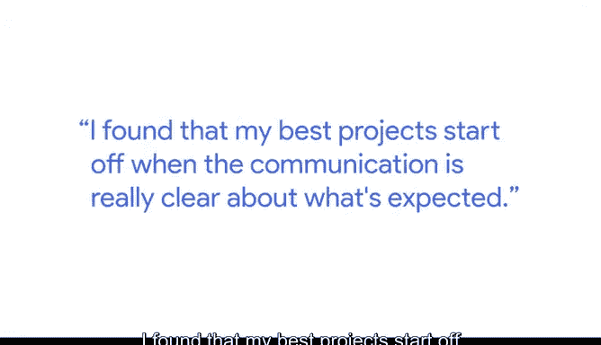

# 谷歌数据分析师第二课《以数据驱动的决策提出问题》ask-questions-make-decisions - P34：34_04_02_Ximena-加入新团队.zh_en - GPT中英字幕课程资源 - BV1RP411e7NV

Joining a new team was definitely scary at the beginning。

 especially at a company like Google where it's really big and everyone is extremely smart。

 but I really leaned on my manager to understand what I could bring to the table and that made me feel a lot more comfortable in meetings while sharing my abilities。

I found that my best projects start off when the communication is really clear about what's expected。

If I leave the meeting where the project is being asked of me。

 knowing exactly where to start and what I need to do， that allows for me to get it done faster。

 more efficiently and getting to the real goal of it and maybe going an extra step further because I didn't have to spend any time confused on what I needed to be doing communicationic is so important because it gets you to the finish line the most efficiently and also makes you look really good。

When I first started， I had a good amount of projects thrown at me and I was really excited so I went into them without asking too many questions at first that was an obstacle because while you can thrive an ambiguity。

 ambiguity as to what the project objective is can be really harmful when you're actually trying to get the goal done and I overcame that by simply taking a stepback when someone askeds me to do the project and just clarifying what that goal was once that goal was crisp。

 I was happy to go into the ambiguity of how to get there。

 but the goal has to be really objective and clear Im humana and I'm a financial analyst。😊。

