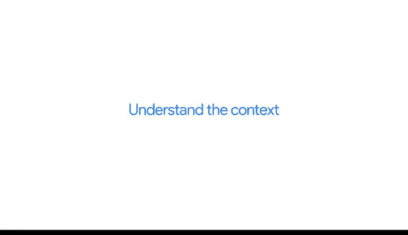

# 谷歌数据分析师第二课《以数据驱动的决策提出问题》ask-questions-make-decisions - P35：35_04_04_从冲突到协作.zh_en - GPT中英字幕课程资源 - BV1RP411e7NV

It's normal for conflict to come up in your work life， a lot of what you've learned so far。

 like managing expectations and communicating effectively can help you avoid conflict。

 but sometimes you'll run into conflict anyways。If that happens。

 there are ways to resolve it and move forward in this video。

 we will talk about how conflict could happen and the best ways you can practice conflict resolution。

A conflict can pop up for a variety of reasons， maybe a stakeholder misunderstood the possible outcomes for your project。

Maybe you and your team member have very different work styles。

 or maybe an important deadline is approaching and people are on edge。

Mismatched expectations and miscommunications are some of the most common reasons conflicts happen。

Maybe you weren't clear on who was supposed to clean a data and nobody claimed it。

 delaying a project， or maybe a teammate sent out an email with all of your insights included。

 but didn't mention it was your work。And while it can be easy to take conflict personally。

 it's important to try and be objective and stay focused on the team's goals。Believe it or not。

 tense movements can actually be opportunities to reevalu a project and maybe even improve things。

 so when a problem comes up， there are a few ways you can flip the situation to be more productive and collaborative。

One of the best ways you can shift the situation from problematic to productive is to just reframe the problem instead of focusing on what went wrong or who to blame。

 change the question you're starting with。Try asking， how can I help you reach your goal？

This creates an opportunity for you and your team members to work together to find a solution instead of feeling frustrated by the problem。

Discussion is key to conflict resolution。 If you find yourself in the middle of a conflict。

 try to communicate， start a conversation or ask things like。

 are there other important things I should be considering。

This gives your team members or stakeholders a chance to fully lay out your concerns。

But if you find yourself feeling emotional， give yourself some time to cool off so you can go into the conversation with a clearer head。

If I need to write an email during a tense moment， I'll actually save it to drafts and come back to it the next day to reread it before sending to make sure that I'm being level headed。

And if you find you don't understand what your team member or stakeholder is asking you to do。

 try to understand the context of their request， ask them what their end goal is。

 what story they're trying to tell with the data， or what the big picture is。

By turning moments of potential conflict into opportunities to collaborate and move forward。

 you can resolve tension and get your project back on track。

So instead of saying there's no way I can do that in this time frame。

 Try to reframe it by saying I would be happy to do that， but I'll just take this amount of time。

 Let's take a step back so I can better understand what you'd like to do with the data。

 and we can work together to find the best path forward。😊，And with that。

 we've reached the end of this section。 Great job。 Learn how to work with new team members can be a big challenge in starting a new role or a new project。

 But with the skills you've picked up in these videos。

 you'll be able to start on the right foot with any new team you join。 So far。

 you've learned about balancing the needs and expectations of your team members and stakeholders。

 You've also covered how to make sense of your team's roles and focus on the project objective。😊。

The importance of clear communication and communication expectations in a workplace and how to balance the limitation of data with stakeholder ask。

Finally， we covered how to have effective team meetings and how to resolve conflicts by thinking collaboratively with your team members。

😊，Hopefully now you understand how important communication is to the success of a data analyst。

 These communication skills might feel a little different from some of the other skills you've been learning in this program。

But they're also an important part of your data analyst toolkit and your success as a professional data analyst。

And just like all of the other skills you're learning right now。

 your communication skills will grow with practice and experience。

