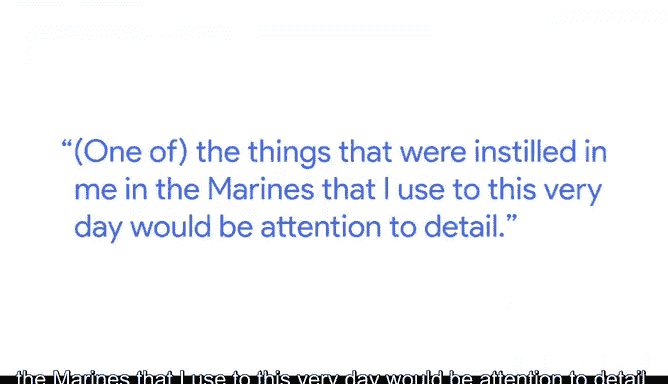

# 谷歌数据分析师第二课《以数据驱动的决策提出问题》ask-questions-make-decisions - P36：36_04_05_Nathan-从美国海军陆战队到数据分析.zh_en - GPT中英字幕课程资源 - BV1RP411e7NV

Hey， I'm Nathan， I'm a principal data analyst in the trust and Safety organization at Google。

I joined the Marine Corps Res when I was attending college and the reserve unit I joined was a field artillery unit。

So after a challenging Marine Corps boot camp， I went to Field Artillery Fire directionion Control School。

And for those of you that might not know fire direction control is considered the brains of field artillery and we used all sorts of computers to do our artillery calculations。

 but just in case the computers went down， we also were trained how to use slide rules as a backup and then a year later had the opportunity to be activated as a truck driver。

Instead of my primary job as a field artillery even and was。

Deployed to Iraq to drive trucks for an infantry company after I got back from Iraq。

 I finished up my bachelor's degree and then worked as an application engineer in Austin， Texas。And。

Eventually。Saw the need to pivot more， to focus more on business。

And that's when I really fell in love with data analysis was when I was learning a lot more about business。

 it actually took me a couple years when I really sparked an interest in data analysis to land a role where I got to do it full time and really get my hands dirty with the data。

Some of the things I did delay the groundwork to be ready and be qualified for that was I took a Coursera course on R。

And I also did some data science hackathons。Where you you know spend an entire weekend at some university and you they have released the data set Friday night and by Sunday afternoon you have to come up with some recommendations so those were two really good ways to。

Really prepare myself， get good experience and really show a strong interest in data analysis my first job where I got to do data analysis full time was at a large bank。

And I was just in heaven， I got to really do SequL for real。And also I got to use Tableau a ton。

 got to go to a Tableau conference was really cool。

 then I was fortunate enough to get an opportunity to move to Google into my current role that's in trust and safety。

And what's super exciting and fulfilling about that is that。you know， similar to the military。

 it has an overall mission of protecting people so that that's super exciting for me the things that were instilled in me in the Marines that I used to this very day would be attention to detail。

That's super important in the military overall， but especially in field artillery。

 secondly is the importance of communication， you have your own details locked in。

 you need to make sure that those are communicated really clearly to other people that you're working with and the third would be collaboration and the military teamwork makes the dreamwork。

 you really rely on the team that's definitely been the case in my post- Marineine Corps career in jobs。

