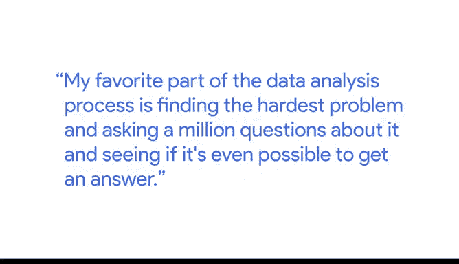

# 谷歌数据分析师第二课《以数据驱动的决策提出问题》ask-questions-make-decisions - P3：03_01_03_Nikki-数据处理流程如何运作.zh_en - GPT中英字幕课程资源 - BV1RP411e7NV

I'm Nikki and I manage the education evaluation assessment and research team My favorite part of the data analysis process is finding the hardest problem and asking a million questions about it and seeing if it's even possible to get an answer So one of the problems that we've tackled here at Google is our nuclear onboarding program which is how we onboard new hires one of the things that we've done is ask the question how do we know whether or not newrs are onboarding faster through our new onboarding program than our old onboarding program where we used to lecture them and we worked really closely with the content providers to understand just exactly what does it mean to onboard someone faster once we asked all the questions what we did is we prepared the data by understanding who is the population of the new hires that we were examining so we prepared our data by going through and understanding who our population。

We by understanding who our sample set was， who our control group was， who our experiment group was。

 where were our data sources and make sure that it was in a format that was clean and digestible for us to write the proper scripts for So the next step for us was to process the data to make sure that it was in a format that we could actually analyze in SQL。

 making sure that it was in the right format and in the right columns and in the right tables for us to analyze the data we wrote scripts in SQL and in R to correlate the data to the control group or the experiment group and interpret the data to understand were there any changes in the behavioral indicators that we saw once we analyze all the data we want to report on it in a way that our stakeholders could understand so depending on who our stakeholders were we prepared reports。

 dashboards and presentations and share that information out once。

Reports were complete we saw really positive results and decided to act on it by continuing our projectbased learning onboarding program it was really satisfying to know that we had the data to support it and that it really really worked and not just that the data was there。

 but that we knew that our students were learning and that they were more productive faster back on their jobs。

