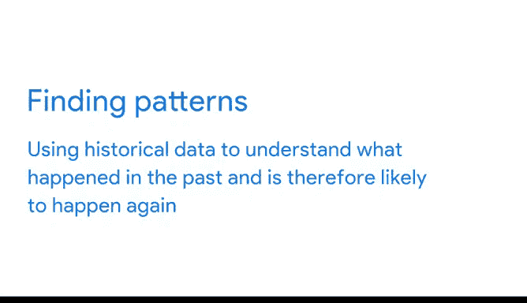

# 谷歌数据分析师第二课《以数据驱动的决策提出问题》ask-questions-make-decisions - P4：04_01_01_常见问题类型.zh_en - GPT中英字幕课程资源 - BV1RP411e7NV

In a previous video， I shared how data analysis helped a company figure out where to advertise its services。

 An important part of this process was strong problem solving skills。 As a data analyst。

 you'll find that problems are at the center of what you do every single day。

 but that's a good thing。 Think of problems as opportunities to put your skills to work and find creative and insightful solutions。

😊，Problems can be small or large， simple or complex。 No problem is like another。

 and they all require a slightly different approach。 But the first step is always the same。

 understanding what kind of problem you're trying to solve。

 And that's what we' are going to talk about now。 Data analysts work with a variety of problems。

 in this video， we're going to focus on six common types。 These include making predictions。

 categorizing things， spotting something unusual， identifying themes， Discing connections。

 and finding patterns。Let's define each of these now， first making predictions。

 this problem type involves using data to make an informed decision about how things may be in the future。

For example， a hospital system might use a remote patient monitoring to predict health events for chronically ill patients。

 The patients would take their health vitals at home every day。

 and that information combined with data about their age。

 risk factors and other important details could enable the hospital's algorithm to predict future health problems and even reduce future hospitalizations。

The next problem type is categorizing things。 This means assigning information to different groups or clusters based on common features。

 An example of this problem type is a manufacturer that reviews data out in shop floor employee performance。

 An analysts may create a group for employees who are most and least effective at engineering。

 a group for employees who are most and least effective at repair and maintenance。

 most and least effective at assembly， and many more groups or clusters。Next。

 we have spotting something unusual in this problem type。

 data analysts identify data that is different from the norm。

An instance of spawning something unusual in the real world is a school system that has a sudden increase in the number of students registered。

 maybe as big as a 30% jump in the number of students。

 A data analyst might look into this upwing and discover that several new apartment complexes had been built in the school district earlier that year。

 They could use this analysis to make sure the school has enough resources to handle the additional students。

 identifyingdentifying themes is the next problem type。😊。

Identifying themes takes categorization as a step further by grouping information into broader concepts。

 So going back to a manufacturer that has just reviewed data on the shop floor employees。First。

 these people were grouped by types and tasks。But now a data analyst could take those categories and group them into the broader concept of low productivity and high productivity。

 This would make it possible for the business to see who is most and least productive in order to reward top performers and provide additional support to those workers who need more training。

 Now， the problem type of discovering connections enables data analysts to find similar challenges faced by different entities and then combine data and insights to address them。

Here's what I mean。 say a scooter company is experiencing an issue with the wheels it gets from its wheel supplier。

The company would have to stop production until it could get save quality wheels back in stock。

 But meanwhile， the wheel company is encountering the problem with the rubber it uses to make wheels。

Turns out its rubber supplier could not find the right materials either。

If all of these entities could talk about the problems they're facing and share data openly。

 they would find a lot of similar challenges and better yet be able to collaborate to find a solution。

 The final problem type is finding patterns。 Data analysts use data to find patterns by using historical data to understand what happened in the past and is therefore likely to happen again。

E-commerce companies use data to find patterns all the time。

 Data analysts look at transaction data to understand customer buying habits at certain points in time throughout the year。

 They may find that customers buy more canbits right before a hurricane。

 or they purchase fewer cold weather accessories like hats and gloves during warmer months。

 They E-commerce companies can use these insights to make sure they stock the right amounts of products at these key times。

All right， you've now learned six basic problem types that data analysts typically face as a future data analyst。

 this is going to be valuable knowledge for your career。Coming up。

 we'll talk a bit more about these problem types， and I'll provide even more examples of them being solved by data analysts。

 Personalally， I love real world examples。 They really helped me better understand new concepts。

 So I can't wait to share even more actual cases with you。 See you there。😊。

