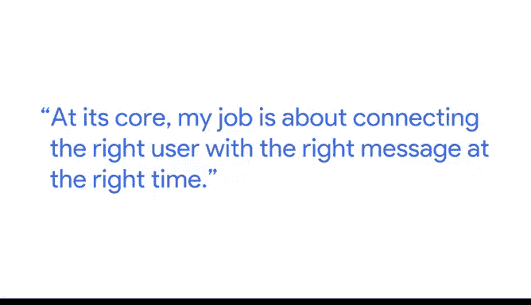

# 谷歌数据分析师第二课《以数据驱动的决策提出问题》ask-questions-make-decisions - P6：06_01_04_Anmol-从假设到结果.zh_en - GPT中英字幕课程资源 - BV1RP411e7NV

Hi， I'm An M， I'm the head of largege Advr marketing analytics within the marketing team at Google at its core。

 my job is about connecting the right user with the right message at the right time。

The first step is really to get a broad sense of a certain pattern that's occurring。 So， for example。

 we know that this particular segment of users is more responsive to this type of content。

 once we're able to actually see this hypothesis through the data。

 we do testing to ensure that the hypothesis is actually correct。 So， for example。

 we would test sending this these pieces of content to this segment of users and actually verify within a controlled environment。

 whether that response rate is actually higher for that type of content or whether it isn't。

 And so once we're able to actually verify that hypothesis。

 we go back to the stakeholders in this case， our marketers and say we've actually proven within a relatively high degree of certainty that this particular segment is more responsive to this type of content and because of that we're recommending that you produce more of this type of content。

 And so our stakeholders really get to see the whole sort of evolution from hypothesis to proven concept。

And they're able to come in with us on the journey on how we're proving out these hypotheses and then eventually turning them into strategies and recommendations for the business。

 So the outcome in this case was that we were able to actually change the way our whole marketing team worked。

😊，To actually make it much more user centric。 So instead of from our perspective。

 coming up with content that we think the users need。

 we're actually going in the other direction of figuring out what users need first。

 proving that they need certain things or they don't need certain things and then using that information going back to marketers and coming up with content that fulfills their need。

 So it really changed the direction of how we produce things。

