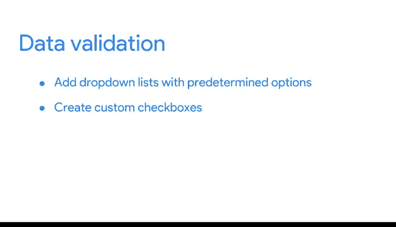

# 谷歌数据分析师第五课《通过数据分析回答问题》analyze-data（中英双字） - P12：12_02_05_数据验证.zh_en - GPT中英字幕课程资源 - BV1q14y1o7Yj

Welcome back。While we're learning about formatting data。

 I want to talk to you about another spreadsheet feature， data validation。In this video。

 I'll teach you a little bit about data validation and show you how to use it。For now。

 when I say data validation， I'm talking about the function。

 which is different from the data validation process。We'll get into that later on。But first。

 let's talk about what data validation does in spreadsheets。 Basically。

 it allows you to control what can and can't be entered in your worksheet。Usually。

 data validation is used to add drop down lists to cells with predetermined options for users to choose from。

If you have a spreadsheet with a lot of collaborators。

 this can make it easier for them to interact with your table。

You can think of it like a multiple choice question on a quiz。

And since you can control what's being entered into the worksheet。

 it cuts down on how much data cleaning you have to do later on。

 Let's figure out how we might do that For this example。

 we'll work on a project with a lot of milestones and deadlines to keep track of。

Let's say our team has a spreadsheet that tracks everyone's progress。

 But instead of making everyone right in where they are and their task individually。

 we can provide a drop down menu with multiple options like not yet started in progress and ready。

 So we'll select the column that we want to add the drop down menus to。 In this case。

 the status column。 Then we'll go to the data pull down menu here at the top and click data validation。

😊，This brings up a pop up menu with options for data validation。 In this case。

 we know that we want to add a list of items for other users to choose from。

 So we'll select the list of items option and the possible criteria and type in the selections we want to create。

 then hit save。 and now all of those cells have drop down menus that we can use to easily mark progress for each task。

 but there's other things that you can do with data validation and spreadsheets too。

 like creating custom check boxes。😊，To do this， let's select the cells under the review column to make a check box that will let us know if tasks have been approved or not。

 We'll go back to the data validation menu。But instead of choosing list from a range。

 we'll choose check box。 There is an option to use custom cell values。

 Let's choose that and put in approved and not approved。Now。

 these tasks can be checked off by whoevers reviewing them， like a project manager。 for example。

 Another way we can use data validation is to protect structured data and formulas。

The more people that are working together in a spreadsheet。

 the more likely someone can accidentally break a formula。But good news。

 the data validation menu has an option to reject invalid inputs。

 which helps make sure our custom tools will continue to run correctly。

 Even if someone puts the wrong data in by mistake。 All right， now， you know。

 three uses for data validation in your spreadsheets。 adding drop down lists。

 creating custom check boxes and protecting structured data and formulas。😊。

Data validation can help your team track progress， protect your tables from breaking when working in big teams and help you customize tables to your needs。

 Com up or learn more about conditional formatting and some ways you can use conditional formatting and data validation together。

 See you soon。😊。

