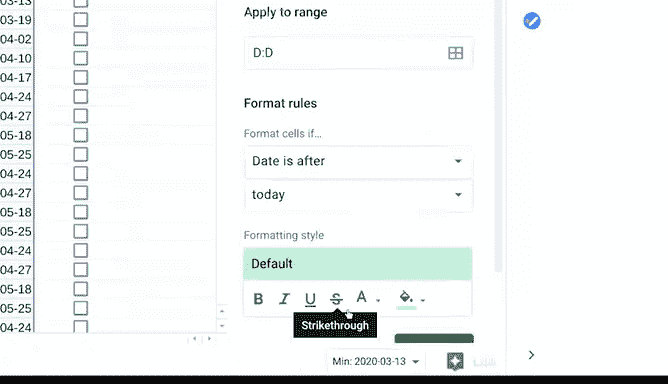

# 谷歌数据分析师第五课《通过数据分析回答问题》analyze-data（中英双字） - P13：13_02_06_条件格式化.zh_en - GPT中英字幕课程资源 - BV1q14y1o7Yj

Hi again， so earlier we talked about conditional formatting as a spreadsheet tool that changes how cells appear when values meet specific conditions。

This lets you add visual cues to your spreadsheets that make it easier to understand your table at a glance。

 and it makes the information in the worksheet clearer to your stakeholders。 In this video。

 we'll take that even further by combining conditional formatting and data validation to create custom tools for our spreadsheets。

 So far， we've used conditional formatting to highlight empty cells that still needed data so that we could quickly pinpoint what information our table was missing and added in。

😊，Now， let's build on that by using it to make our scheduling table easier to read at a glance。

Here's a table we worked with when we covered data validation。

 It's tracking the status of different tasks on our project for our team to check on。

 But now there's even more tasks than the last time we looked at it。

This table has useful information， but it takes a second to understand right now。

 we don't have a visual on how many tasks are in progress or how many upcoming deadlines there are。

But if we color coded those elements of the table， we could quickly see key pieces of data really easily。

Let's start with the status column， column C。In the last example。

 we created these drop down menus with the data validation tool。 Now。

 we can use conditional formatting to add some color。

Let's go to the conditional formatting option under the format menu。

This brings up a sidebar where we can select our range， rule in formatting style。

We need to decide which rows to apply a formatting to when the condition we set is met。

 We can click this button in the range options to select all of the rows we're applying the formatting to instead of  tightening it in。

 Now that we have those cells selected。 We can choose the rule that we want to apply to these cells。

 We already have drop down menus with specific text。

 So we can choose format cells If text is exactly from the rules。 for our first rule。

 Let's write not yet started as the text condition。

 Then we'll choose a color to apply to those cells that have not yet started in them。 Let's use red。

😊，Now， all cells that have not yet started selected from the drop down menu will be read。

Let's hit the add another rule button to add conditional formatting to our other status options。

 Let's add the condition in progress， next。We can make that one yellow。

And then we'll add one last rule for ready。 Let's choose green。

And there now we have an easy to understand visual Q that tells us how many tasks are in progress and how many are completed。

 We can also combine data validation and conditional formatting to track upcoming deadlines。

 We have a column of dates called review by this date。 First。

 let's use the data validation functionality to make sure users only enter valid dates。

 We'll go back to the data drop down at the top， pull up data validation and select date as our criteria。

😊，Then we can go to the format menu at the top。 go down to conditional formatting and open the sidebar again。

We'll click the select range icon and select the review by this date column。Now， under format rules。

 we can select date is after， which will give us another option。 Let's choose today。

And finally， let's choose the color for these cells。😊。

So if the date listed in these rows is after today， it'll be filled in orange。

 you can also choose a specific locked date if needed。But for now， let's go with today day。 Now。

 all of the upcoming review dates have an easy to see color code。

 So anyone using this table can quickly reference these deadlines。

 You'll find that some spreadsheet programs like Excel have built in color codes that you can use to。

 And there you go。 Now you know how to use data validation and conditional formatting to create custom tools and visual cues that make your information easy to understand。

 There's a lot of different ways to use these tools。

 So feel free to experiment with them in your own spreadsheets coming up will keep learning about new tools for spreadsheets and SQL。

 By for now。😊。

