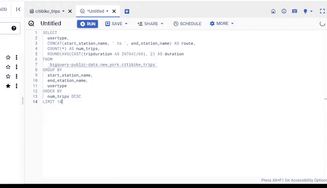

# 谷歌数据分析师第五课《通过数据分析回答问题》analyze-data（中英双字） - P14：14_02_03_合并文本字符串以获得洞察.zh_en - GPT中英字幕课程资源 - BV1q14y1o7Yj

Great to see you back In this video， we'll build on what we've learned about concatenate and import range by exploring a new sequel query。

 concat。😊，You might remember that concatenate is a function that joins together two or more text strings。

 And as a quick reminder， a texturing is a group of characters within a cell。

 most often composed of letters。You've seen how that works within a single spreadsheet。

But there's a similar function in SQel that allows you to join multiple text strings from multiple sources。

 concat。 Let's use concat to combine strings from multiple tables， to create new strings。

For this example， we'll use open data from Cityti bikeike。

 which is a public bicycle sharing system in New York。As you've learned earlier。

 open data initiatives have created a ton of data for analysts to use Openness or open data is free access usage and sharing of data。

😊，It's a great resource。 If you want to practice or experiment with the data analysis tools you've been learning here。

 You have open access to the New York City bike sharing data。

 which has information about the use of shared bikes across the city。😊。

So now we can use conca to pull and concatenate data from different columns stored here。

The first thing we need to do is figure out which columns we need。 That way。

 we can tell SQL where the strings we want are。 For example。

 the bike sharing company has two different kinds of customers。

 one time paying customers and subscribers。 Let's say we want to find out what routes are most popular with different user types。

 To do that。 We need to create strings of recognizable route names that we can count in sort。

We know that the information we need is in the stations and Tris table。

 So we'll start building our query from there。 First。

 we'll input select user type to let SQL know that we want the user type as a column。

 Then we'll use concat to combine the names of the beginning and ending stations for each trip in a new column。

 This will create one column based on the routes people take。

 We also need to input a title for this new column。

 We'll type in as route to name the route column using those beginning and ending station names we combined with concat。

This will make these route names easy for us to read and understand。After that。

 we want SQL to count the number of trips。 So we'll input count to do that。

 We can use an asterisk to tell it to count up the number of rows in the data we're selecting。

 In this case， each row represents a trip， which is why we can just count all of the rows we've selected。

 We'll name this output as N U M underscore trips。😊，Now。

 let's also get the average trip duration for each route。 In this case。

 we don't need the exact average so we can use the round function to round up。We'll put that first。

 and then in the parentheses， use average to get the average trip duration。

 We'll also want this data to be an integer form for this calculation， so we'll input Cas as int 64。

BigQu stores numbers and a 64 B memory system， which is why there's a 64 after integer in this case。

 Next， we'll divide it by the number of rows and tell it how far we want it to round Two decimal places。

 We'll name this output as duration。Next， we'll need to tell SQL where this information is stored。

 so we'll use from and the location we're pulling it from。

Since we're using count and average functions in our select clause。

 we have to use group by to group together summary rows。 let's group by the start station。

 the end station and the user type for this query。Finally。

 we'll use order by to tell it how we want to organize this data For this。

 we want to figure out the most common trips so we can input the number of trips column and use D， E。

 S C to put it in descending order。 Finally， we only want the top 10。 So let's add limit 10。😊。

And now， thanks to Concat， we can easily read these route names and trace them back to real places。😊。

And we can see which kinds of customers are taking which routes。

 which could help the bike sharing company understand their user base in different parts of the city and where to keep more bikes for people to rent。

Being able to combine multiple pieces of data can give you new ways to organize and analyze data。

 And there's a lot of different tools to help you do that。 Now， you've seen concad in action。

 And later， you will come across another similar query， join。😊，But up next。

 we'll talk more about working with strings。 See you soon。

