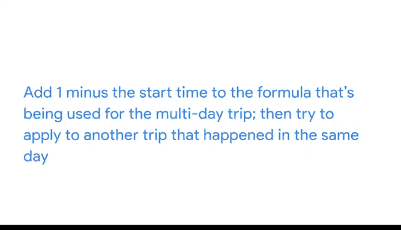
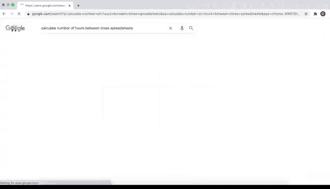

# 谷歌数据分析师第五课《通过数据分析回答问题》analyze-data（中英双字） - P16：16_02_01_遇到困难时.zh_en - GPT中英字幕课程资源 - BV1q14y1o7Yj

Hi there。 So data analysts spend a lot of time problem solving。

 And that means there's going to be times when you get stuck。

 but the trick is knowing what to do when that happens in this video。

 we'll talk about the importance of knowing how to get help。

 whether that means asking someone else for help or searching the Internet for answers。😊。

Asking other people about a problem you're having can help you find new solutions that move a project forward。

 So it's always a good idea to reach out to your peers and mentors。

 especially if they're working with you on that project。😊。

Your team members have valuable knowledge and insight that can help you find the solution you need to get unstuck。

Sometimes we spend a lot of time spinning our wills saying， I can do this myself。

 but we can be way more productive if we engage with other people。

 find new resources to lean on and try to get as many voices as we can involved。 For example。

 let's say you're working with the bike trip time data from the previous videos。

 Maybe you're trying to find the average time between bike rides in a given month。

 calculating the difference between bike rides before midnight is easy。

 But you can run into a problem if the elapsed time crosses into the next day。

 If someone went on a bike ride at 11 PM。 but the next ride wasn't until 6 AM。

 Your formula will return a negative number because the end time is less than the start time。

 You know that you can add one minus the start time。

 If two bike rides start and end on different days。

 But that formula won't work on times that happen in the same day。😊。

And it's pretty inefficient to scroll through every bike ride to pinpoint these special cases。

 You need to find a way to build a conditional formula， But you aren't sure how。

 So you decide to check in with other analysts working on your team to see if they have any ideas。

 You could send them a quick email or stop by their desk to find out if they have a minute to talk it over with you。

 turns out they had a similar problem on a previous project and they're able to show you a conditional formula that you could use to speed up your calculations。

 Great， They suggest using an if formula like this。

 This basically says that if the end time is larger than the start time replace the standard end time minus start time formula with one minus start time plus end time。

😊。

Now， it's also possible that your team members don't have an answer。 That's okay， too。

 There's definitely someone else with the same problem asking the same questions online。

Knowing how to find solutions online is an incredibly valuable problem solving tool for data analysis。

 There's also all kinds of forums where spreadsheet users can ask questions。

 and you never know what you can turn up with just a basic search。😊，For example。

 let's say you look at calculate number of hours between times spreadsheets and find a helpful walk through for a more complicated formula using mod。

 This flips the negative values into positive ones， solving your calculation problem。

Whether you're asking someone， you know or searching the Internet for answers。

 reaching out for help can give you some really interesting solutions and new ways to solve problems for future analysis。

 Coming up， We'll learn even more about searching for solutions online。 See you soon。😊。

