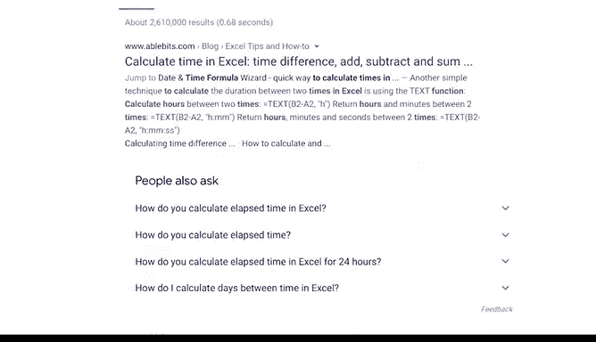

# 谷歌数据分析师第五课《通过数据分析回答问题》analyze-data（中英双字） - P18：18_02_04_遇到挑战不必担心.zh_en - GPT中英字幕课程资源 - BV1q14y1o7Yj

Welcome back。Earlier， we talked a little bit about finding resources online to help you figure out solutions to problems during analysis。

 The Internet has so much knowledge and advice to offer， but you need to know how to find it。

So in this video， we'll talk more about finding answers online。

 You might think that great data analysts don't regularly rely on outside resources。

 but that's a myth。The best data analysts know that finding answers to their problems online can be empowering and give them new knowledge for the future。

Being able to find new ideas and combine them with what you already know can help you come up with some amazing things。

So don't be afraid to turn to the Internet to find your answers。

 It's a great resource that lots of analysts use。 me included。😊。

But let's talk more about how you can make sure you're using web resources in the best way possible。

 There's a combination of best practices that you can use to guide your search for answers online by practicing the thinking skills we've learned in this program using the right data analytics terms and your basic knowledge of analysis tools。

 you have everything you need to find answers and apply them to your own work。

And it starts with how you approach a problem mentally。

You've learned about different kinds of thinking skills and how to practice them and your data analysis work from analytical to mathematical to structured thinking。

This helps build your mental model or your thought process and the way you approach a problem。

Data analysts use these thinking skills to approach a problem logically and break it into smaller parts。

Building this into your own problem solving process can help you pinpoint specific questions which you can use to find resources more easily。

For example， maybe you keep running into an error and your analysis。

 you narrow it down to two possibilities， your formula or the data itself。

You double check your formula， and you see that it's correct。

 So now you know that you need to make sure that data has been entered correctly。

 You consider the problem logically and tracked it down to the source using your mental model。 Next。

 it's important to use the right terms when searching for solutions。

Knowing how to frame data analytics questions with the same language other analysts are using will help you get more search results。

 and it'll help you understand what other analysts are saying。 For example。

 maybe you need to use the left four characters of a string for a column in SQL。

How would you search for this， Searching for four characters in a column is a little vague and might not bring up specific resources。

 but left string query SQL uses some keywords that other data analysts are also using to talk about these things。

On top of being able to use the right terms to search online。

 you also need to be familiar with basic tools。That way。

 when an online resource is walking you through a new function in a tool you've used before。

 you'll know how those tools work。 For example， if you find a spreadsheet formula online。

 you need to understand how formulas work to apply it to your own spreadsheet。

Or maybe the data set you're working with is too large for a single spreadsheet。

 and you'll need to switch to SQL。Having a variety of tools in your toolkit is important as a data analyst。

But just as important as knowing when to use them。If you find yourself stuck on a problem。

 it can be a good idea to take a step back and reconsider how you're approaching a task。

We've covered a lot of tools that you can use as a data analyst throughout this program。And later。

 you'll learn one more。 R。 We'll talk about R more later on。

 But here's a sneak peek to get you excited for it。😊，R is another programming language。

 but it's not a database language like SQL。It's a programming language frequently used for statistical analysis。

 visualization， and other data analysis。Our is a little different from other tools we've been working with。

 but it's a great compliment for the tools you're already using。😊。

And it will give you more potential solutions when you run into problems。

Using the thinking skills we've learned throughout this program。

 the right terms and your understanding of different analysis tools will get you ready for the next steps of this process。

 actually searching for answers online。There's a lot of resources like program support websites and forums where other data analysts are asking and answering questions。

In an earlier video， we ran into a problem trying to calculate the time elapsse between bike rides and the bike sharing data。

Maybe our first search calculate time in spreadsheets didn't turn up the answers we needed by thinking about our specific question and how other data analysts might be asking it。

 we could change that search into conditional formula for calculating e lapse time in spreadsheets。

And now we have more specific solutions to our problem。

Finally， being able to modify example code to fit your own needs is so useful。

 understanding the syntax of formulas and functions for different tools will allow you to take what you learned online and make it work for you and maybe even build on it to create a whole new solution。

😊，For example， the mod formula we built to account for trips that started and ended on different days and our bike sharing data。

The mod formula we found online wasn't created for the data we were working with。

 but because we are familiar with spreadsheet tools。

 we were able to apply it to our data and use it as a solution to our problem。

Great data analysts know how to find and use resources online to help them build new solutions to problems they face by using the thinking skills you've already learned in this program and using your knowledge of data analytics。

 tools and terms you can too。😊，And once you've found some answers to your problems。

 you can build them into your analysis work to get past any challenge you might face。

