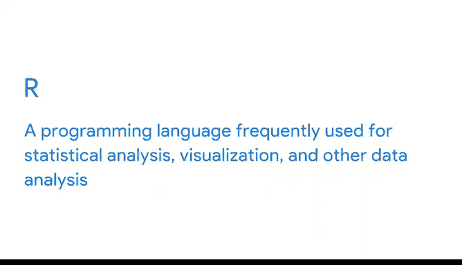

# 谷歌数据分析师第五课《通过数据分析回答问题》analyze-data（中英双字） - P19：19_02_05_何时使用何种工具.zh_en - GPT中英字幕课程资源 - BV1q14y1o7Yj

Hello there。 In these videos， you've been introduced to spreadsheets， SQL and so many other tools。

 We've also talked about choosing the right tool before you start a project。

 but sometimes you find yourself stuck on a problem during your data analysis。😊。

That might mean it's time to reconsider which tool you're using for the job。For example。

 if you are working with a simple spreadsheet， maybe 5 to 10 rows in a few columns。

 then pivot tables are a great way to visualize that data。

 But if that spreadsheet is more than a million rows。

 it'll start to crash making a pivot table hard to complete when you find yourself working with a huge spreadsheet that keeps crashing。

 you might switch to SQL to pull the data you need from different locations in a database instead of from a single spreadsheet。

😊，You might remember that SQL can handle trillions of rows of data and is now a standard language for working with database programs。

 SQL is great for querying， updating and optimizing data。

 but trying to analyze your data with only SQL can get complicated。

As you continue to progress as a data analyst， you might find yourself spending a lot of time building long。

 nested queries and then debugging them。It might be time to consider another tool， R。

Our is a new tool that you'll work with later on。 But for now。

 I'll tell you a little bit about it so that you can start getting excited。

R is another programming language， but it's not a database language like SQL。

It's a programming language frequently used for statistical analysis， visualization。

 and other data analysis。

R is a little different from other tools we've been working with。

 but it's a great compliment for the tools you're already using with R。

 you'll be able to analyze and visualize data in all kinds of new ways。😊。

We'll talk about R more later on， but I hope this sneak peek gives you an exciting first look。

 Having a variety of tools in your toolki is important as a data analyst。

 but just as important as knowing when to use them。😊，If you find yourself stuck on a problem。

 it can be a good idea to take a step back and reconsider how you're approaching a task。

Do you have too much data for a single spreadsheet， switch to SQL。

Are you spending more time debugging queries than actually analyzing data。

 Maybe you should consider R。You also know how to find answers online now。

 So if you ever run into a problem and need to try a different tool。

 a quick search can be really helpful。 There might be resources on or someone else may have had the same problem。

 and posted about it。This is great if you start feeling stuck on a problem。

And you might even find a new way to use a tool you're already familiar with。

And that brings us to the end of this module。 Great job。 We've covered a lot of information。

 We learned about converting and formatting data， how to combine multiple pieces of data and how to search for help。

 when you need support during your analysis。 Coming up next， you'll take on the weekly challenge。

 As always， feel free to go back over anything we've learned from these past videos。

 Then I'll see you for the next video。 Good luck。😊。

