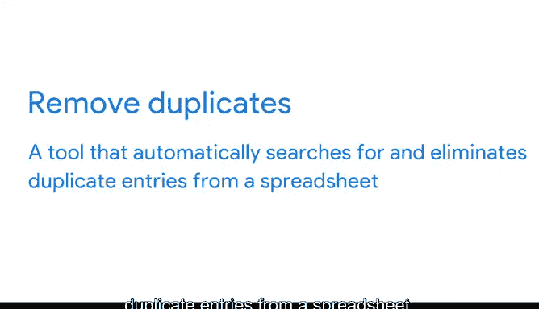

# 谷歌数据分析师第五课《通过数据分析回答问题》analyze-data（中英双字） - P21：21_03_02_准备使用VLOOKUP.zh_en - GPT中英字幕课程资源 - BV1q14y1o7Yj

Hi again， in this video， we'll prep our data for Vlookup， a data aggregation tool。

 As you learned before， data aggregation is the process of gathering data from multiple sources in order to combine it into a single summarize collection。

Data aggregation can give you all kinds of information about the data you are looking at。

 For example， in marketing， you can aggregate data from an ad campaign to see how it performed over time and for particular customers。

Travel companies use data aggregation to figure out how much their competitors charge for a certain flight。

 hotel room or rental car type。Then they can make sure they price their own products as competitively as possible。

 One thing these businesses all have in common is that they can use V look up to help them achieve these goals。

 As a reminder， V lookup stands for vertical look up。 Basically。

 it's a function that searches for a certain value and a column to return a corresponding piece of information。

 Earlier， we used V lookup to take the value in one cell and search for a match and another。😊。

We were able to match a product code made up of numbers and letters that lived in one spreadsheet to the actual name of the product that lived in another。

😊，But before any of that can happen， we need to make sure our data is properly prepared。

As you've heard many times， clean data is much more likely to give you accurate results。

 So let's start with the first common data cleaning task，  different data types。 For example。

 a data set might have dates formatted as numbers or numbers represent as text strings instead of numeric values when data is not in a consistent format or a format that the spreadsheet application recognizes。

 V lookup won't know what to do with that data， and it'll return an error。Earlier。

 you learned how to convert numbers to dates using the format tool。

 So now let's focus on converting text to numeric values To do this。

 you could use the format menu to select a type of number。But you could also use the value function。

 Val is a function that converts a text string that represents a number to a numerical value。

 Here is an example。 In this spreadsheet， the numbers in column A are currently text strings。

We can confirm this by running a simple sum function。The syntax is equal to some open parentheses。

 and then the items you want to add together here， it's a 2 to a 4。

 The colon says we're including everything between these two references。Now。

 you can add a close parentheses and press enter， or you can click and drag on the cells you want inside the parentheses to save a little bit of time。

 The result is 0。 That's because the function doesn't work on text strings。

 But if we apply the value function and automatically converts that text to a numeric value。

 to do that， we'll type equals value that an open parentheses。 In。

 we reference a cell whose value we want to convert。 In this case， a2。

 So now if we close the parentheses and press enter， you'll notice that the 1，2，3 is numeric。

 If we drag it down the column。 the 4，5，6 and 7，8，9 also become numeric。

 Now we contest it by running another sum function。 we'll type equals sum and an open parentheses。

 Then B2， colon and B 4。 So B2， B3 and B4 are included in the sum。

 close the parentheses in press enter。 Now， it shows that the total。😊，Is 1368。Okay。

 the next common error comes from having extra spaces in your spreadsheet。As you've learned。

 when data is copied from one source to another， sometimes a few leading or trailing spaces tag along。

These can cause problems when using Vlookup。 So we want to make sure to use trim during the data cleaning process。

 trim automatically deletes any extra spaces added to the cell。Another typical mistake in V lookup。

 which you can easily catch during data cleaning are duplicates。

If there are duplicate rows in the search， it will return only the first match it finds。

As you learned before， remove duplicates is a tool that automatically searches for and eliminates duplicate entries from a spreadsheet。

Using Re duplicates， as you saw in a video a little while ago。

 is a great way to get rid of duplicates and help make sure you find the right record during the lookup。

It's always good to remember that clean data is the foundation that everything else is built on。

 And V lookup can be a very useful data cleaning tool。

 And the next video will keep exploring more ways you can use V lookup。 See you there。😊。

