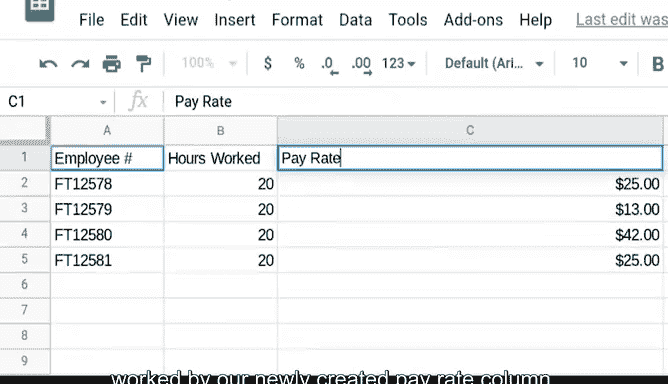

# 谷歌数据分析师第五课《通过数据分析回答问题》analyze-data（中英双字） - P22：22_03_03_VLOOKUP实战.zh_en - GPT中英字幕课程资源 - BV1q14y1o7Yj

Hi， and welcome back。 In a previous video， we talked about V lookup for data cleaning。

 We also discussed the importance of preparing our spreadsheet before putting V lookup to use。 Now。

 we're going to experience it in action。 As a quick reminder。

 V lookup is a spreadsheet function that vertically searches for a certain value in a column to return a corresponding piece of information。

 Let's start with V lookup syntax。 In this example，103 is a value to search for。😊，A2。

 column B26 is the range that will be searched。 As you may remember。

 V lookup will not recognize column names such as A， B or C。

So we use a number to indicate the column。Lastly， false tells V lookup to find an exact match。

If this said true， the function would return only a close match， which might not be what we want。

Okay， now， let's put V lookup to use。 One of the most common things data analysts do with V lookup is populating data in one spreadsheet from another。

 Here's an example。 Let's say we're working with data that exists in two different spreadsheets。

 but we need information from both in order to answer our business question。

 V lookup can connect two sheets together on a matching column to populate one single sheet。

Check it out in this spreadsheet， we have employee ID numbers and their rates of pay。

And in this spreadsheet， we have the same employee ID numbers and how many hours each person worked。

So we can use V Lookup to search for the rate of pay from the employee rate spreadsheet and add it to the employee H spreadsheet。

The formula is equals V lookup， open parentheses， then A2。

 which is the first employee ID number and the employee hours spreadsheet。Next， we add a comma。

Then the name of the spreadsheet we want to search in， employee rates。

Be sure to put single quotation marks around the spreadsheet name and add an exclamation point after it。

This is the way to reference the other spreadsheet。Next， we add the range， which is A 2 through B 5。

 As you saw in a previous video， we can also choose to add dollar signs to lock the range with absolute cell references。

 This prevents them from changing when copying the formula to other cells。

Add another comma then a two。 The two indicates that we want to search for a match in the second column。

 column B for rate of pay。Finally， one more comma， and we add false to look up an exact match。

Drag the formula down the column， and now we can use a simple multiplication formula to calculate each person's paycheck by multiplying hours worked by our newly created pay rate column。

Great work。 In an upcoming reading， you'll learn even more about V lookup and access some helpful V lookup reminders and resources。

😊，Belook up is one of the more complicated functions， so keep practicing。

