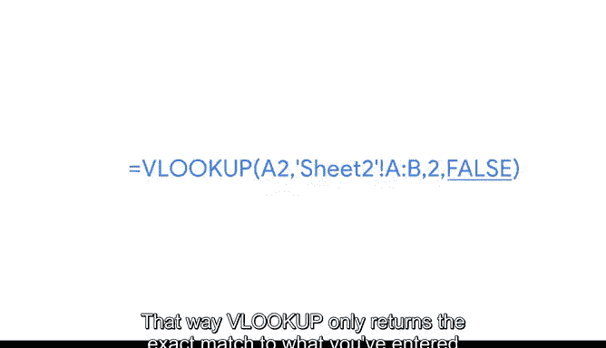

# 谷歌数据分析师第五课《通过数据分析回答问题》analyze-data（中英双字） - P23：23_03_04_识别和修复常见VLOOKUP错误.zh_en - GPT中英字幕课程资源 - BV1q14y1o7Yj

When people start out in data analytics， they often think that those of us who've been in the field for a while know everything。

 But trust me， we're all still figuring things out。 And a lot of the time。

 that means troubleshooting。 troublelesshooting has to do with asking the right questions。

 And that's what we'll focus on in this video。 We'll learn how you can use troubleshooting to solve all kinds of problems to do this。

 we'll need to talk about some of the limitations of V look up and then practice fixing some of the most common problems that data analysts faced。

 Some of the troubleshooting questions I like to ask myself。How should I prioritize these issues。

 tryinging to solve lots of problems all at once can feel overwhelming。

 I find it helps when you take things one at a time。Next， I ask in a single sentence。

 what's the issue I'm facing。 This helps to clarify what's really going on so I don't get bogged down with extra details。

 After all， if you don't have a clear objective before looking at the data。

 you can find just about anything。 It's always best to start with your own clear understanding of the situation。

 then let the data tell you if you're on the right track or not。

 The next question I ask myself is what resources can help me solve the problem。

 The Internet is one of the best resources out there。 If you have a question。

 chances are thousands of others run into exactly the same thing。

 So a quick search can be really helpful。 and it's good to remember that people are resources， too。

 don't be afraid to ask questions。 not only is it a great way to learn。

 it can also help you build strong relationships with your colleagues。

 And a final important question I think about how can I stop this problem from happening in the future。

 if a new procedure。😊，Our guideline can stop the same issue from popping up again。

 That's a great time saveer。 All right， let's start by noting that Vlookup only returns the first match it finds。

 even if there are lots of possible matches。 Something else to keep in mind is that V lookup can only return a value from the data to the right。

 It can't look left。Good news。 There's a simple solution。

 Data analysts usually get around the problem by copying and pasting a column to the left of the data they want to look at。

 This way， the look up value is in the leftmost column， and the data they want is to the right of it。

😊，Here's another problem I see a lot。 Let's say the first few rows of A V lookup have returned the correct result。

 But when you drag the function down the column， problems start popping up。

This is probably because the table array part of the function hasn't been locked or made absolute。

An absolute reference is a reference that is locked so that rows and columns won't change when copied。

 You can fix this issue by wrapping the table array and dollar signs。 As you learned a while back。

 the dollar sign controls how the reference will be updated。

 They make sure that the corresponding part of the reference doesn't change。

 Something else that can throw off your V looker results are version control issues。 In other words。

 a function worked perfectly at first， but then something in the spreadsheet it was referencing changed。

 For example， maybe a user inserted a column。 So now the columns in your function no longer direct V look up to the right place。

 When something like this happens， it'll return in incorrect value。

There are a few actions data analysts can take to ensure this doesn't happen。 First。

 lock the spreadsheet。 This stops other people from making changes。To do this in sheets， select data。

 then protected sheets and ranges。In other spreadsheet applications。

 there are other tools that do the same thing。 Next， choose what you want to protect。 In this case。

 we want to protect the entire sheet。 Then you can set permissions to either show a warning or restrict who can edit。

Choose only you。 then done。But keep in mind， there will be times when other people need to work in the spreadsheet。

 So locking them out might make you pretty unpopular with your coworkers。 When that's the case。

 you can use match， which is a function used to locate the position of a specific look up value and can help you with version control。

 We won't get into that right now。 But just know that it's an option in case you ever need it。😊。

The final problem we'll talk about has to do with exact and approximate matching When using V lookup。

 you're likely to get different results， depending on whether you enter the word true or false within your function。

 True tells V lookup to look for approximate matches。

 and false tells V lookup to look for exact matches。 So if a function looks like this。

 It's telling V lookup to find the closest match to the text or number we're looking for。

 It's important to note that V lookup starts at the top of a specified range and searches downward vertically in each cell to find the right value。

 It stops searching when it finds any value that's greater than or equal to the lookup value。😊。

That's why data analysts typically use false like this。 That way。

 V lookup only returns the exact match to what you've entered in the lookup value。

V lookup is one of the most popular lookup and reference functions in spreadsheets。

 It's also one of the trickiest Com up， you'll learn about more of these common challenges。

 Everything you learn will help you run into fewer problems when you start using V lookup as a future data analyst。

