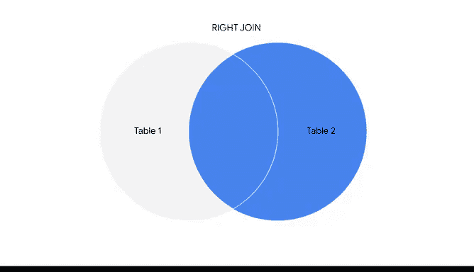
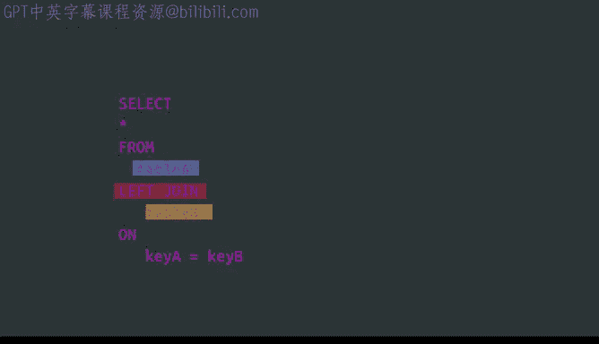
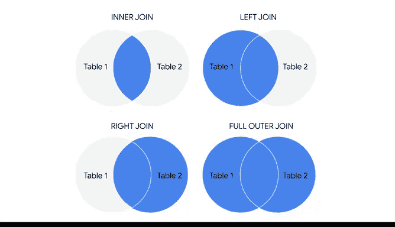

# 谷歌数据分析师第五课《通过数据分析回答问题》analyze-data（中英双字） - P24：24_03_03_探索连接操作的工作原理.zh_en - GPT中英字幕课程资源 - BV1q14y1o7Yj

Hey， welcome back。 so far， we've checked out a few different tools you can use to aggregate data within spreadsheets。

 In this video， we'll cover how to use join in SQL to aggregate data and databases。 First。

 I'll tell you a little bit about what a join actually is。

 And then we'll explore some of the most common joins in action。 Let's get started。

 joinin is a SQL clause that's used to combine rows from two or more tables based on a related column。

 Basically， you can think of a join as a SQL version of Vlookup。 which we just covered。

 There are four common joins data analyst use In， left， right and outer。😊。

Here's a handy visualization of what each join actually does。

 We'll use these to help us understand these functions。

 Joins help you combine matching or related columns from different tables。

 When we learned about relational databases， we refer to these values as primary and foreign keys。

Primary keys reference columns in which each value is unique to that table。

 but that table can have multiple foreign keys， which are primary keys and other tables。 For example。

 in a table about employees。 The employee I D is a primary key， and the office I D is a foreign key。

 Joins use these keys to identify relationships in corresponding values。

An inner join is a function that returns records with matching values in both tables。

 If we think about our tables as the circles of this Venn diagram。

 then an inner join would return the records that exist where the tables are overlapping。

For the records to appear in the results table， there'll have to be key values in both tables。

The records will only merge if there are matches in both tables。When we input join into SQL。

 it usually defaults to inner join。 So a lot of analysts will use join as shorthand instead of typing the whole query。

 A left join is a function that will return all the records from the left table and only the matching records from the right table。

😊，Here's how you can figure out which table is left or right。An English and sQL。

 reread from left to right。 The table mentioned first is left。

 and the table mentioned second is right。 You can also think of left as a table name to the left of the joint statement and right as a table name to the right of the joint statement。

 in this diagram， you'll notice that the entire left tables colored in。

And that's the overlap with the right table， which shows us that the left table and the records it shares with the right table are being selected。

Each row in the left table appears in the results， even if there are no matches in the right table。

Right join does the opposite。 It'll return all records from the right table and only the matching records from the left。

You can get the same results if you flip the order of the tables and use a left join。 For example。

 select from table A。 left join。 table B is the same as select from table B， right join table A。

Finally， there's outer join。Outer join combines right and left join to return all matching records in both tables。

This means it will return all records in both tables。

 If there are records in one table without a match。

 it'll create a record with null values for the other table。

 Using joins can make working with multiple data sources a lot easier。

 and it can make relationships between tables more clear。😊，Here's an example。

Let's say we're working with employee data across multiple departments。

 We have an employees table and a departments table。

 which both have some columns like department I D。We can use different join clauses to help us pull different data from our tables and aggregate it。

Maybe we want to get a list of employees with their department name。

 excluding any employee without a department ID。😡，Because the department I D record is used in both tables。

 we can use an inner join to return a list with only those employees。 As a quick reminder。

 analysts will sometimes just input join for an inner join。 But for this example， we'll write it out。

 So to build this query， we'll start with select and as to tellsQL how we want the columns titled。😊。

Then we'll use from to tell it where we're getting this data。 In this case， the employee's table。

And then we'll input inner join in the other table we're using， which is departments。

We can specify which column in each table will contain the matching join key by writing onEmploys department underscore ID equals departments do departments underscore ID。

Now let's run it。And there。Now， we've got a list of employee names and department I Ds for the employees that have those I Ds。

 but we could use left or right join to return a list of all employee names and their departments when available。

 Let's try both really quickly。 So this will start similar to the last query。

 We'll put in select as and from again。But this time。

 we'll say left join and use on like we did with the last query。When we execute the query。

 we get back this new list with the employee names and departments。

 But you'll notice there's nu values。These are places where the right table。

 which is departments in this case， didn't have corresponding values。

Let's try right join just to test it out。 This query will be almost the same。

 Only difference is that we'll use the right join clauses to return all of the rows from the right table。

 whether they have matching values in the table to the left of the join statement or not。

In this case， the right table is departments。Now， let's try out one last join outer。

Outor join will fetch all of the employee names and departments。 Again。

 this query will start a lot like the other ones we've done。

 Will you select as and from to choose what data we want and how We'll grab this from the employees table。

And put full outer join with the department's table to get all of the records from both。

 We'll also use on again here。 Now we can run this。

And we'll get all of the employee names and departments from these tables。

 There will be nulls in the department dot name column and the employee do name column in roll columns because we've joined columns that don't have matching values。

And there。😡，Now， you know how joins work。 Joins are super useful when you need to work with data from multiple related tables。

 They give you a lot of flexibility with how you combine and view that data。

 And if you ever have trouble remembering what inner， right， left or outer join do。

 Just think back to our Venn diagram。 We'll keep learning about aggregating data in SQL next time。

 See you soon。😊。

