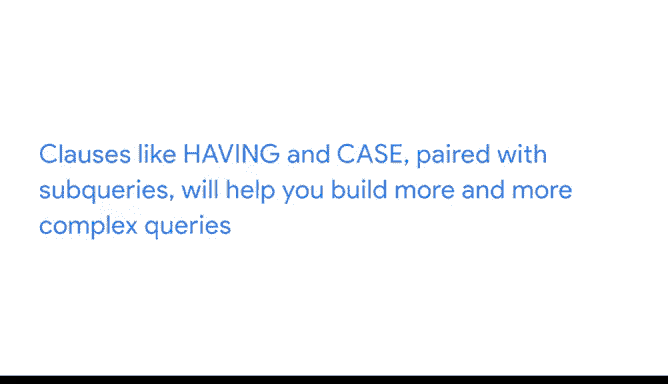

# 谷歌数据分析师第五课《通过数据分析回答问题》analyze-data（中英双字） - P26：26_03_04_使用子查询聚合数据.zh_en - GPT中英字幕课程资源 - BV1q14y1o7Yj

Hey there。 So we've got some experience nesting subqueries into our sQL statements to perform more complicated queries。

 Now， it's time to talk about how to aggregate data with subqueries。 coming up。

 we'll learn about some new subquery statements and use them to aggregate data。

 The query we're going to build in this video is pretty advanced。

 It's going to be a little complicated。 But I know you've got what it takes。 Let's get started。

 We've used functions like where to filter our data before。

 but the where function can't be used with aggregate functions。 For example。

 you can use where on a statement and follow it with group by。

 But when you want to use group by first and then use where on that output。

 you'll need a different function。 This is where having comes in。

 Having basically allows you to add a filter to your query instead of the underlying table when you're working with aggregate functions。

 That way， it only returns records that meet your specific。😊，ConditionSimilarly。

 case returns records with your conditions by allowing you to include if slash then statements in your query。

So let's try to aggregate our data with subqueries and test out these new functions。

 Let's say we're working with a company that makes socks that we talked about earlier。

We've been asked to calculate what percentage of the orders are fulfilled by each warehouse。

Basically， we're interested in knowing which warehouses are delivering the most orders。

 We've seen these tables before， but as a quick refresher， here's the orders table。

You can see the columns here， order I， customer ID， warehouse I， order date and ship date。

 And if we pull up the warehouse table， we can check out its columns。 We have the warehouse I。

 warehouse alias， the maximum capacity， the total number of employees and the state where the warehouse is located。

Before we start building the rest of our query， we'll want to alias our table names。 As a reminder。

 alias S is when you temporarily name a table or column in your query to make it easier to read and write。

This example query is a little bit more complicated than the ones we've seen before。

 So aliasing will help save us some time。 We'll start by aliasing the warehouse table in our from statement。

 The from statement in this query is near the end。 but we'll build this first so that we can use the alias everywhere else。

 We'll simplify it to just warehouse for the rest of this query。

 We know that we're going to join these tables together。

 So let's add that while we're working on this part of the query anyway。😊。

We're using a left join here because we want all the information from our warehouse data。

 even if it doesn't show up in the orders table。Then we'll alias the orders table as part of this statement。

Now， both of our tables have temporary names we can use。

 and we've already finished a joint statement。 But before we can build the beginning of this query。

 let's go ahead and add our group by statement after this join。

 We'll group these by the warehouse I D and name。And now we'll go back to the beginning of the query。

We'll select the warehouse I。Then we'll use concat to combine the strings with the warehouse's state and alias。

As the warehouse name。Then we'll use count to get the number of orders per warehouse。Next。

 we'll build in a sub query to pull the total number of orders placed across all warehouses。

 We' input， select again， and then write the sub queryry and parentheses。

We'll put an asterisk after count to indicate that we want to include everything from the orders table。

And finally， we'll close out the sub queryry and use as to name this column total orders。

Now that our subcore logic is complete， we can use a case statement to create categories for our warehouses based on how many orders they will fulfill。

Will represent these as percentages。 You to notice count in the statement a few times。

 We'll start by saying when the number of orders from our order table is less than or equal to 0。2。

 Then the table will say， fulfilled 0 to 20 per cent of orders。And then we'll use when again。

 to indicate that。When the number of orders is greater than 0。2。And less than or equal to 0。6。

It'll say fulfilled 21% to 60% of orders。After that。

 we can use else to have everything that doesn't meet the criteria of our case statement， say。

 fulfilled more than 60% of orders。😊，Then we'll use end as to name this column fulfillment summary。

That brings us back to the portion of the query we've already written。

 but we're going to add a having statement at the very end of this query。

Our warehouse table has warehouses that are currently being built。

 and we want to filter those out since they aren't fulfilling orders yet。

 we can use having to only include warehouses that have at least one order。Now。

 before we execute this query， let's take a moment to look at the whole thing。

We have an outer select， a count sub query， a case statement， a join。

 and having all wrapped into one query。 We've built a really complex query。

 So let's run it to see the new table。 And there now we can easily identify what percent of our company's total orders are being fulfilled by each warehouse。

 These warehouses met are criteria。 and we can see here in the fulfillment summary column。

 The percentage categories we outlined in our case statement。😊，Obviously。

 since we included a having statement to specify only warehouses with at least one order。

 there aren't any warehouses currently under construction in this table。

That really complicated query we wrote created the specific table of data we can use to easily compare how these warehouses are performing。

There you go。 That's a quick taste of what it's like to work with subqueries and data aggregation。

 Cas like having， in case， paired with subqueries will help you build more and more complex queries。

 which lets you do more and more complex things in SQL。😊。

