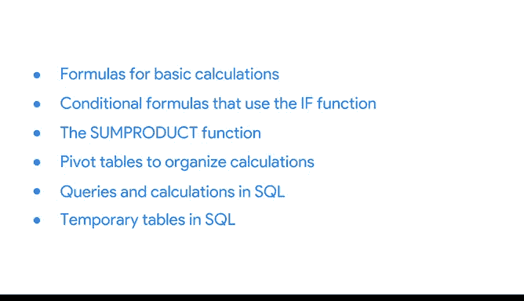

# 谷歌数据分析师第五课《通过数据分析回答问题》analyze-data（中英双字） - P28：28_04_01_数据计算.zh_en - GPT中英字幕课程资源 - BV1q14y1o7Yj

Hi， good to have you back。Coming up， we're going to be reviewing some familiar concepts and then using those concepts to explore new ones。

As a data analyst， you'll use key tools and processes over and over。

 but you'll also learn new things as you grow in your job。

 it could be anything from building a new kind of analysis to a timesaving shortcut。

When I first got to Google， I relied on just a couple of programs and tools to access data and do my analysis。

 But I soon realized that I wasn't working as efficiently as I wanted to。

 Once I got comfortable pulling data and analyzing it using SQL。

 It allowed me to be a lot more efficient than before。

 and the better I got at SQL and pulling the data from data tables。

 the faster I completed my analysis。 I was hooked。😊，Over the next few videos。

 I'll show you some ways to be as efficient as possible while completing calculations during your analysis。

 We'll start by revisiting spreadsheets where we'll look at formulas for basic calculations。😊。

Then we'll move into conditional formulas that use the if function to check whether a condition is met through a calculation。

 After that， we'll explore the multi functional some product function。

 Try saying that five times quickly。 Some product adds and multiplies all in one step。

 So it's very useful。😊，Next， we'll take another look at pivotvo tables。

 If you've skipped around and it's your first time learning about them。

 you'll get to know all about them。 Pivot tables have tons of uses。

 including organizing your calculations。 We'll then pivot to SQL， pun intended。

 We'll show how queries and calculations go hand in hand in SQL。😊。

We'll also look at temporary tables in SQL， which are helpful for temporarily storing your data during analysis。

 We'll be covering lots of new concepts in these videos。

 So feel free to hit the pause button at any time to think through the problem or steps to try it on your own。

😊。

And you can always review the videos as much as you need to。So to recap。

 we'll have a little bit of a review and then cover some all new concepts， all about calculations。

Are you ready？Good， me too。

