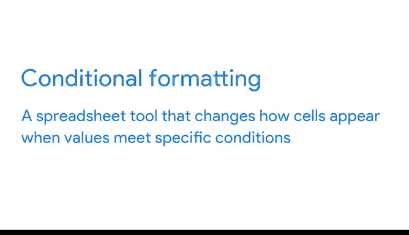

# 谷歌数据分析师第五课《通过数据分析回答问题》analyze-data（中英双字） - P29：29_04_02_常用计算公式.zh_en - GPT中英字幕课程资源 - BV1q14y1o7Yj

Hey there。 you probably do a lot of calculations in your daily life。

 Maybe it's figuring out how much to tip someone or balancing your budget。

 You might do some of these calculations in your head or with paper and pencil。

 or the calculator on your phone。 You might even have shortcuts to use to make the calculations easier。

 You'll perform a lot of calculations as a data analyst， too。

 But they'll involve more numbers in a wider range of calculations。

 That's where you'll put your data analyst tools to work。

 We'll show you how you can use formulas in a spreadsheet to complete some of the most basic calculations。

 formulaulas are one of the many shortcuts that data analysts use。 But rest assured。

 even though they're shortcuts， they'll still calculate with complete accuracy。

 We've covered a lot of these calculations earlier in the program。

 But if you skip that part and want a refresher we'll review them here。😊。

These calculations will also be more advanced than the ones we've covered so far。

But they'll also be closer to what you might use on the job。

 We'll be using Google sheetets in this video， but you can also use Excel。

 The steps might look a little different in Excel， but the outcomes will be the same。Okay。

 let's try out some calculations with sales data from a discount store chain。

 We'll look at data for one of the stores in the chain。 Our objective。

 use the existing sales data to find any trends。 This is a great way to see a lot of the ways formulas can be useful in your analysis。

😊，We'll start by finding annual sales over the years 2011 to 2020。

 The date is already organized in columns by month and in rows by year。

 but we don't have the total sales for each year yet。

 We can use a sum function to help us figure that out。We'll add the sales from 20111。

 we'll add a heading for the annual sales column。Then we can type our sum function in a formula。

 All formulas begin with an equal sign， So we'll type that first。

 followed by some and then in open parentheses。 After the open parentheses。

 we need to tell the formula which cells are being added。In this case。

 we need data from the whole row， which begins in cell B2 B2 is a cell reference we'll use instead of typing each cell one by one。

 we can put them in the formula quickly by selecting cell B2 and dragging the fill handle across the row to the last cell with sales data M2。

All right， now we'll complete the formula by closing the parentheses and pressing enterter。

And just like that， we've calculated the total cells for 2011。

 Here's another shortcut we worked with in an earlier video。

 The fill handle is the tiny box in the corner of each cell。

 You can use it for lots of things like selecting multiple cells for a formula or continuing a pattern across several cells。

 The fill handle definitely qualifies as a shortcut。

 We can use the formula we created to calculate the total cells for the other years in the data set。

😊，All we have to do is drag the fill handle down the other cells in the annual cells column and we'll have total sales data for the rest of the years in the data。

Let's say we also need to find the growth in annual sales from year to year。

This would be a good time to think through the problem before we try to solve it。

 Do we have the data we need to solve this， Not yet。

 Think backwards like this helps us plan out the steps to move forward。

 The first step we'll need to do is calculate the total sales by year。😊。

Then we'll measure the rate of change between years。We'll start by labeling a new column。

In this case， we won't need to use a function or parentheses since we're only using data from two cells。

 we can just use the name of those cells。 We'll type in equal sign and then click and cell in3。

 which automatically populates that cell in the formula。Next。

 we'll add a minus sign to the formula because we're subtracting to find the difference between two consecutive years。

Clicking and sell In gives us the total from 2011， which we can then subtract from the total from 2012。

 Then we hit enter and get our sales growth from 2011 to 2012。

We're definitely getting some useful data here， so let's keep going。

 We can also use our sales growth to find the growth rate between the two years。😊。

We'll show this as a percentage， so we'll head our column with the percent sign and growth。

To do this， we'll divide the total in cell 03 by the annual cells from 2011 and sell N2。

A slash is a symbol that a formula recognizes as division。

 so we'll place that between the two cell references。In Presto， there's the growth rate。

Growth rates are usually shown as percentages， which can be easier than a decimal to read and understand。

 So let's change this number to a percentage Time for another shortcut。

 All we have to do is click the percent style button， and our growth rate will become a percentage。

We can select the cells for both the total growth and the growth rate to populate the rest of the two columns。

We have some negative numbers， but that just means that there was negative growth from one year to the next。

Okay。We've got just a few more things to calculate for our stakeholders。

 Next up is finding the average cells。 We want to compare cells between months to learn if there is a trend。

 So we'll add this in a row instead of a column。 This will line up our averages under each month。

To find our averages， we'll calculate the total and then divide that total by the number of values at it to get it。

We can do this by using the average function。Between our parentheses。

 we'll select the cells that contain the sales data for January， B2 through B11。

We'll duplicate that formula across the row through December to look for trends。Right away。

 we know that summer months and December have the highest average sales。

Since our stakeholders will want to understand our findings quickly and easily。

 we'll add a little visualization to the data with conditional formatting。

You'll learn more about data visualizations like conditional formatting soon。

 But here's a sneak peek。 Conditional formatting is a spreadsheet tool that changes how cells appear when values meet specific conditions。

So let's apply conditional formatting to the cells with the average sales by month。

We'll use a color scale to show the range of averages with the lowest monthly average remaining as white。

And will apply shades of green to the rest of the values。The brighter the green。

 the higher the average。Now when we share our analysis with our stakeholders。

 they will be able to tell right away which months have the highest average sales。Okay。

 just a couple more steps to complete our analysis。Now。

 we need to find the minimum and maximum for average monthly sales with a data set this small。

 it might be easy to find the minimum of maximum values without a formula。

 but it's still good practice to use one。 not to mention， using a formula helps prevent human error。

We'll again， rely on formulas with functions to do these calculations。

 We'll start with the lowest monthly average。Our function here is men。

 followed by the cells with the average month。B12 through M12。After we press enter。

 the lowest monthly average is calculated。We can repeat the same steps to find the highest monthly average。

In this formula， we'll use the same data， but we'll replace min with max for maximum。

So for this store location， sales are strongest in December and weakest in January。

 We could share these findings with stakeholders if they've met our objectives。😊，If they have it。

 we might need to continue with our analysis。 Either way。

 I hope you've learned how spreadsheet formulas can be valuable tools when doing calculations coming up。

 We'll check out more formulas。 See you soon。