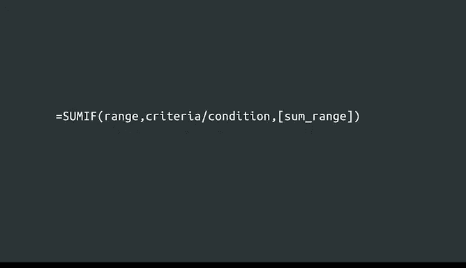
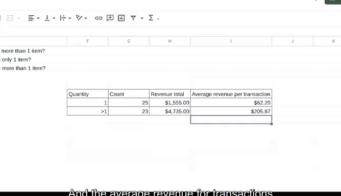

# 谷歌数据分析师第五课《通过数据分析回答问题》analyze-data（中英双字） - P30：30_04_03_函数与条件.zh_en - GPT中英字幕课程资源 - BV1q14y1o7Yj

Welcome back。 One of the first calculations most kids learn how to do is counting。

 So after they learn adding。 and that doesn't go away。 no matter what age we are。

 we're always counting or adding something， whether it's change at the grocery store or measurements in a recipe。

 Data analysts do a lot of counting and adding to。 And with the amount of data you'll come across as a data analyst。

 you'll be grateful to have functions that can do the counting and adding for you。

 So let's learn how these functions， count if and some if can help you do calculations for your analysis more easily and accurately。

 We'll start with the count if function， you might remember。

 count if from some of the earlier videos about data cleaning。

 count if returns the number of cells that match a specified value。 Earl。

 we showed how count if can be used to find and count errors in a data set。😊。

Here we'll only be counting。 just a reminder， though。

 while we won't be actively searching for errors in this video。

 you'll still want to watch out for any data that doesn't look right when doing your own analysis。

 As a data analyst， you'll look for and fix errors every step of the way。For this example。

 we'll look at a sample of data from an online kitchen supplies retailer。

Our stakeholders have asked us to answer a few questions about the data to understand more about customer transactions。

 including the revenue they're bringing in。We've added the questions we need to answer to the spreadsheet。

We'll set up a simple summary table， which is a table used to summarize statistical information about data。

We'll use the questions to create the attributes for our table columns count revenue total。

An average revenue per transaction。Each of our questions ask about transactions with one item or transactions with more than one item。

 so those will be the observations for our rows。We'll make quantity the heading for our observations。

We'll also add borders to make the summary table nice and clear。The first question asks。

 how many transactions include exactly one item？To answer this。

 we'll add a formula using the count if function and cell G11。We'll begin with an equal sign。

Count if。And an open parentheses。Column B has data about quantity。

 so we'll select cells B3 through B50， followed by a comma。Next。

 we need to tell the formula the value that we're looking for in the cells we've selected。

 We want to tell the data to count the number of transactions if they equal 1。 in this case。

 between quotation marks， we'll type an equal sign and the number one because that's the exact value we need to count When we add a closed parentheses and press enter。

 we get the total count for transactions with only one item。Which is 25。

We can follow the same steps to count values greater than one。But this time。

 because we only want values greater than one， we'll type a greater than sign in our formula instead of an equal sign。

Getting this information helps us compare the data about quantity。Okay。

 now we need to find out how much total revenue each transaction type brought in。

Since the data isn't organized by quantity， we'll use the sum if function to help us add the revenue for transactions with one item and with one more item separately。

 some if is a function that adds numeric data based on one condition。

Building a formula with some， if is a bit different than one with count if。

 They both start the same way with an equal sign and the function。

 But a sum if formula contains the range of cells to be evaluated by your criteria and the criteria。

 In other words， some if has a list of cells to check based on the criteria you set in the formula。

 Then the range where we want to add the numbers is placed in the formula。

 If that range is different from the range being evaluated。

There's commass between each of these parts， adding a space after each comma is optional。

So let's try this。 In cell H 11， we'll type our formula。The range to be evaluated is in column B。

 so we'll select those cells。The condition we want the data to meet is for the values in the column to be equal to one。

 so we'll type a comma and then inside quotes an equal sign in the number one。

Then we'll select the range to be added based on whether the data from our first range is equal to 1。

This range is in column C， which lists the revenue for each transaction。

So every amount of revenue earned from a transaction with only one item will be added together。

And there's our total， since this is revenue， we will change the format of the number to currency。

 so it shows up as dollars and cents。So the transactions with exactly one item earned $1555 in revenue。

 Let's see how much the transactions with more than one item earned。Okay。

 let's check out the results。 Just like with our count if examples。

 the second sum if formula will be the same as the first， except for the condition。

 which will make greater than one。When we run the formula。

 we discover that the revenue total is much higher，$4735。

 This makes sense since the revenue is coming from transactions with more than one item。 Good news。😊。

To complete our objective， we'll do two more quick calculations。 First。

 we'll find the average revenue per transaction by dividing each total by its count。

 This will show our stakeholders how much of a difference there is in revenue per transaction between one item and multiple item transactions。

😊，This information could be useful for lots of reasons。 For example。

 figuring out whether to add a discount on purchases with more than one item to encourage customers to buy more。

We'll put these calculations in the last column of our summary table。

 you might remember that we use a slash in a formula as the operator for division calculations。

The average revenue for transactions with one item is $62。20。

And the average revenue for transactions with more than one item is $205。87。

And that's it for our analysis。 Our summary table now gives stakeholders and team members a snapshot of the analysis that's easy to understand our count if and some if functions played a big role here。

😊，Using these functions to complete calculations， especially in large data sets。

 can help speed up your analysis。 They can also make counting and adding a little more interesting。

 Nothing wrong with that。 And coming up， we'll explore more functions to make your calculations run smoothly。

 by for now。😊。

