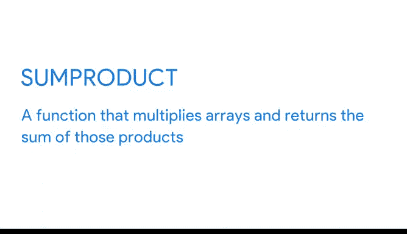
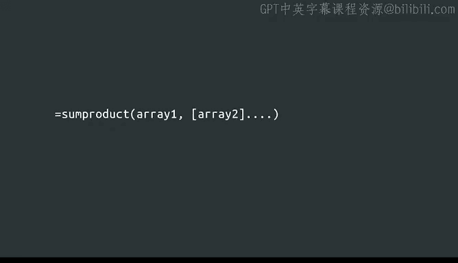
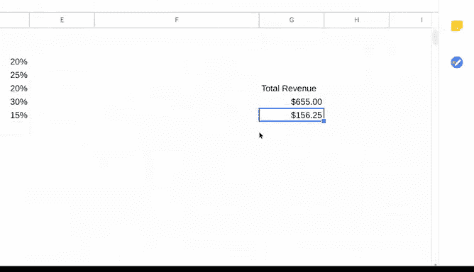

# 谷歌数据分析师第五课《通过数据分析回答问题》analyze-data（中英双字） - P31：31_04_05_复合函数.zh_en - GPT中英字幕课程资源 - BV1q14y1o7Yj

Hi again， data analysts love discovering new ways to work on their analysis。

 especially when those new ways simplify their work。

 I know I'm a big fan of learning new tricks to complete tricky task。

Instead of trying to find a new way to do something every time I do an analysis。

 I try to learn from other people by asking questions and getting help when I need it。

The people I work with like to use the phrase stealing with pride。

 All this means is that you should feel no shame for using a process in your analysis that you learn from someone or somewhere else。

 fellow team members， message board posts， online searches。

 I've used all of these resources for ideas。 with pride。 Of course。

 I always cite my sources when I do。😊，That's a super important step， to remember。

The sum product function is also one of those tricks that analysts come across。

 either on their own or from another source。You can also think of it as a shortcut for doing more complex calculations。

 We'll show you how some product works。 And when you might use it to make your work life simpler。

 Some product is a function that multiplies arrays and returns the sum of those products。😊。

And here's what the sum product formula looks like。Equal sign， the sum product。

 followed by an open parentheses and arrays being multiplied and then added together。

Each array is separated by a comma。 An array is kind of like a range in a spreadsheet。

 But keep in mind， an array is a collection of values in cells， not the cells themselves。

So when added to a formula， the sum product function multiplies each of the values in two or more arrays together。

 For example， each value in the array of cells， B3 through B7。

Can be multiplied by its corresponding value in the array of cells C3 through C7。So B3， times C3， B4。

 times C4， and so on。It'll then return the sum of all of those multiplications。

Let's check out an example using data from a kitchen supplies company。

 You might remember this example from our count， if and some， if video。

We've been given some data about a product order， including the quantity of each product that was sold in the order and the unit price。

 which tells how much one of each product cost。 Our job is to use the data in these two columns to find out the total revenue for this order。

And that's where some product comes in to find the total revenue we need to do both addition and multiplication calculations。

 So first off， we need to find the revenue that each item brought in separately。

If we did this without some product， we'd have to multiply each quantity by its unit price。

 50 times a25， $25 times $5， and so on。Then we'd have to add all of those revenue amounts together to get the total revenue。

Fortunately， the S product function does all of that for us。

Let's add the label total revenue and sell g5 and then click g6 to input our formula。

We'll then start our formula with an equal sign and the function， followed by in open parentheses。

 It's good to remind ourselves that the arrays we add to our formula should always be inside the parentheses。

😊，Next， we'll select C B3 through B7 for the first array， followed by a comma。

The comma acts as a separator between the two arrays and the formula。

Then we'll select cell C3 through C7 for the second array。

 followed by a closed parenthesesis to complete our formula。

We don't need to include the brackets in our actual formula。

We included them in the syntax example to clearly define each array for you。

Then we press enterter to get our total revenue。Since we're dealing with revenue。

 we'll format out the number as currency。So we've learned the total revenue is $655。

 but that's not the actual profit from the sales of these kitchen supplies。

 because we haven't included the profit margin in our calculations。

 The profit margin is a percentage that indicates how many cents a profit have been generated for each dollar of sale。

So in our dataset， product number 789 has a profit margin of 20%。

 meaning each product sold earns a total profit of 20 cents for every dollar。

 In just like the calculation for revenue。 We can save time finding profit margin by using the sum product function。

 There's only one difference between the formula for profit margin and revenue in this spreadsheet。

 But it's an important difference。 to start and sell G7， we type the same first part of the formula。

Then we include the two arrays in the same way as well。But instead of ending our formula。

 we add another comma， followed by another array。 This time。

 we'll select the cells with the profit margin D3 through D7。We'll finish our formula。

 and our calculation is complete。

The sum product function saved us from having to multiply each individual revenue amount by each profit margin percentage。

 then add each profit margin amount together。 usingsing somepro for calculations is a time saver and helps you avoid making mistakes。

 definitely a trick worth remembering and there's more worth remembering about calculations coming up next。

