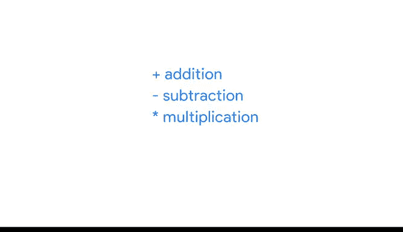
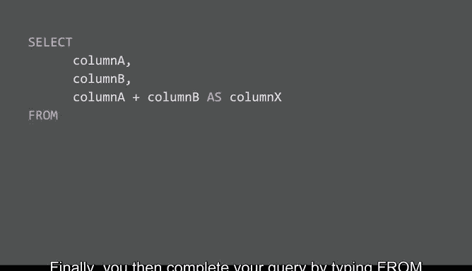
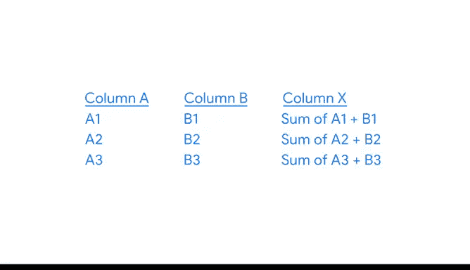
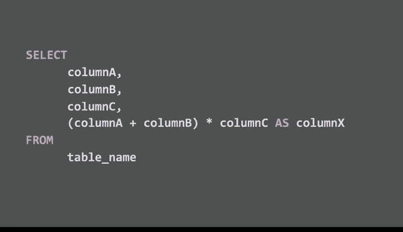
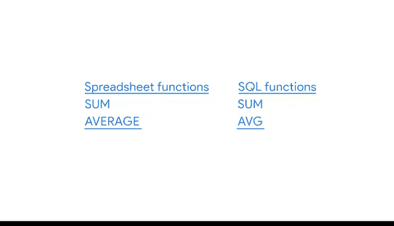

# 谷歌数据分析师第五课《通过数据分析回答问题》analyze-data（中英双字） - P34：34_04_01_查询与计算.zh_en - GPT中英字幕课程资源 - BV1q14y1o7Yj

By now， you probably know that there's more than one way to do the daily task of a data analyst。

Calculations are no exception。 As we've shown in earlier videos。

 you can complete the same calculations and lots of different ways and spreadsheets。

You can also complete them using SQL。In this video。

 we'll give you an overview of how SQL calculations compare to spreadsheet calculations。

Let's look at the arithmetic operators that are used in both spreadsheets and SQL。

 An operator is a symbol that names the type of operation or calculation to be performed in a formula。

As you learned earlier， the four basic arithmetic operators in spreadsheet formulas are the plus signed for addition。

 the minus are hyphen for subtraction， the asterisk for multiplication。

 and the forward slash for division。

These same operators calculate data in the same way when writing queries in SQL。

The operators are embedded in the queries when pulling data from a database。

 just like spreadsheet formulas， there's a few different ways to perform calculations using queries。

Let's look at the syntax for one possible query。 The syntax of a query is its structure。

 It should include all the specific details of the data you want to pull into a new table where those details should be placed。

 So if you want to add values from two columns of a table。

 you start with the select command followed by the name of your first column。

 Then the name of your second column。 Then you'd add the names of both columns with a plus sign between them。

After that， you've typed。As followed by the name you'd like to give the column with the added totals。

Finally， you then complete your query by typing from and then the name of the table that you're pulling the data from。

Running this query would get you a table showing the two columns whose values are being added together。

 plus a new column showing the sums of those values。

The operator in this query is a plus sign since values are being added。 If you needed to subtract。

 multiply or divide， you'd follow the same steps using the appropriate operators。

If you need to use more than one arithmetic operator in a calculation。

 you'd use parentheses to control the order of the calculations。

So if we included column C in our query， we could place parentheses around column A plus column B。

We then add an asterisk if we're multiplying， followed by column C。

This query would return in a new column The sum of the values in column A and B multiplied by the values in column C。

 All right， now， let's say you only wanted the remainder from a division calculation。Well。

 you need a different operator for this。 the modlo operator。

The modular operator is represented by the percent symbol。

 This is an operator that returns the remainder when one number is divided by another In a spreadsheet。

 you could complete the same calculation using the mod function。

 This brings us to another similarity between calculations and spreadsheets in SQL。 A lot of times。

 you can use functions instead of operators to complete calculations。For example。

 the sum function can complete addition problems in spreadsheets and SQL。

 The average function in a spreadsheet is the same as the A V G function in SQL。 They both return。

 The average value of a set of numbers in SQL， These functions are considered aggregate functions。

 because they perform a calculation on one or more values in return a single value。

 You'll learn more about how theyre used with the group by command and a query soon。

 So those are the basics of SQL calculations。 Know how to write a query for a calculation is a good first step。

😊。

Stay with us， and you'll learn more about calculations in SQL。Bye for now。

